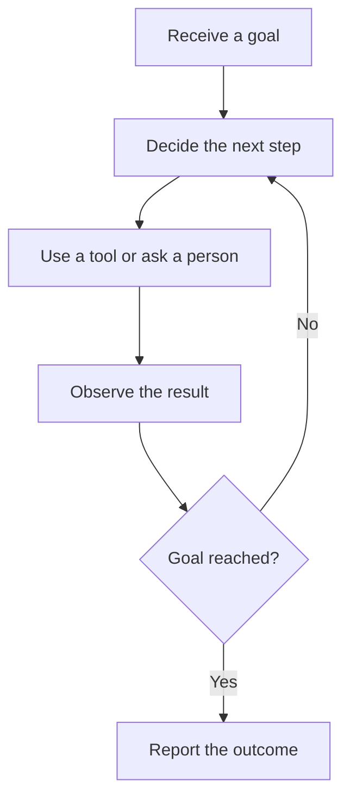
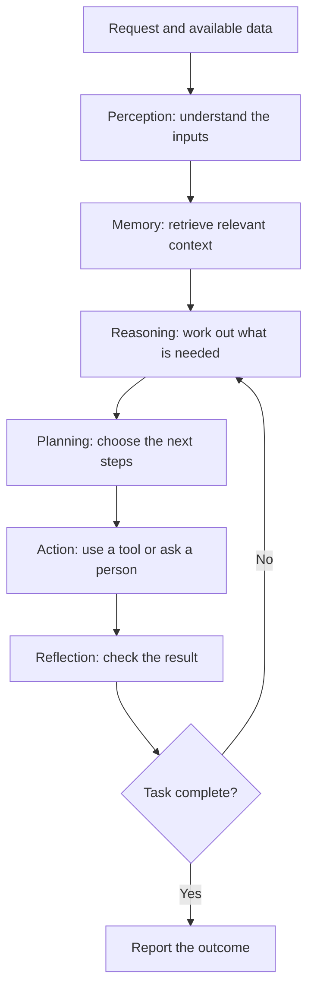
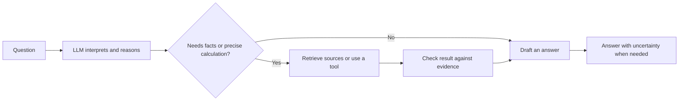
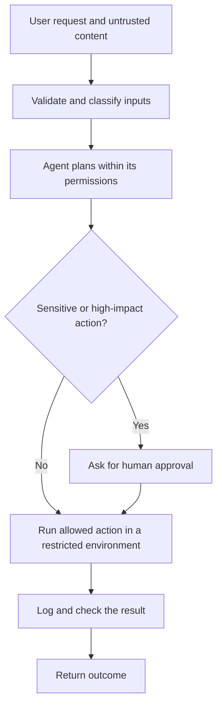
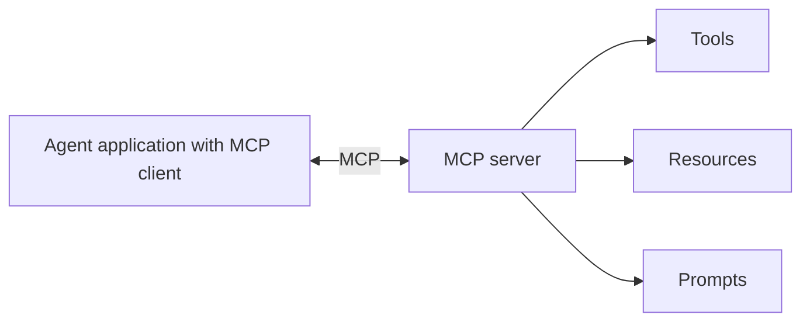

# 1.1 What Is Agentic AI?

**Agentic AI is AI that works toward a goal by choosing and carrying out steps.** Instead of only answering a question, it can decide what to do next, use tools, check results, and adjust its approach.

Think of the difference this way:

- **Chatbot:** “Here’s a recipe for dinner.”
- **Agent:** “I’ll find a recipe using what’s in your fridge, check whether you have the ingredients, and suggest a shopping list.”

An agent is not necessarily fully independent. A person can approve important steps, and the system may be limited to specific tools and actions.

## How AI systems evolved

| Era | How it worked | Example |
|---|---|---|
| **Rule-based** | Followed rules written by people | “If temperature is high, turn on the fan.” |
| **Statistical** | Learned patterns from examples | Predict whether an email is spam |
| **Deep learning** | Learned complex patterns from large amounts of data | Translate text or generate images |
| **Agentic AI** | Uses a model to pursue a goal through multiple steps and actions | Research a topic, compare sources, and prepare a summary |

These eras build on one another. Agentic AI often uses deep-learning models, but adds a **goal-driven loop** around them.

## What makes a system agentic?

An agentic system typically has some combination of:

- **A goal:** It knows what outcome it is trying to reach.
- **Decision-making:** It chooses a next step based on the situation.
- **Tools:** It can interact with APIs, databases, or other software.
- **Feedback:** It checks what happened and can change course.
- **Multi-step work:** It can break a task into smaller actions.

For example, a travel-planning agent might search for flights, compare options, and ask before booking. It should not be given permission to purchase tickets unless that is explicitly intended.

## Agentic does not mean “uncontrolled”

“Autonomous” describes **how independently** a system can act. “Agentic” describes its **goal-oriented behavior**. A system can be agentic while still requiring human approval.

- **Human-in-the-loop:** A person approves actions before they happen.
- **Human-on-the-loop:** The system acts, while a person monitors and can intervene.
- **Fully autonomous:** The system acts without routine human approval.
- **Controlled autonomy:** The system can act within defined limits, such as using read-only tools or spending only up to an approved amount.

**Key idea:** Agentic AI is most useful when a task involves several steps—but its tools and permissions should be limited to what the task actually needs.
---

# 1.2 Core Components of an Agent

An AI agent is like a small team of helpers working together: one gathers information, another decides what it means, and another takes action. These “helpers” are **layers** in the agent’s design—not necessarily separate AI models.

Imagine an agent asked: **“Find a time for a meeting that works for everyone, then draft an invitation.”**

## The six core layers

1. **Perception — What’s happening?**  
   The agent receives information, such as the user’s request, calendar data, or messages. It parses and organizes those inputs into something usable.

2. **Memory — What should it remember?**  
   Memory can hold information for different lengths of time:
   - **Working memory:** Details needed right now, such as the meeting’s duration.
   - **Short-term memory:** Relevant conversation or session history.
   - **Long-term memory:** Information kept for future tasks, such as a user’s preferred meeting hours.

   An agent should only store information that is useful and appropriate to retain.

3. **Reasoning — What does the information mean?**  
   The agent considers constraints and evidence. For example, it checks which meeting times overlap across attendees’ calendars.

4. **Planning — What steps should it take?**  
   The agent turns the request into a sequence: check calendars, find an overlapping time, prepare an invitation, and ask for approval.

5. **Action — Carry out a step**  
   The agent uses a tool, such as a calendar API. Actions can have real consequences, so sensitive actions—like sending invitations—may require confirmation.

6. **Reflection — Did that work?**  
   The agent checks the result. If a calendar lookup fails, it can report the problem or try an allowed alternative rather than pretending it succeeded.

## How the layers work together

**Example:** The agent checks everyone’s availability and finds a suitable time. Before sending the invitation, it asks the user to confirm. If approved, it sends the invite and checks that the calendar reports success.

In short: **perception gathers, memory recalls, reasoning evaluates, planning organizes, action does, and reflection checks.**
---
# 1.3 LLMs as Reasoning Engines

A large language model (LLM) is the part of an agent that interprets and generates language. It can often solve reasoning tasks, but it does not guarantee that its answers are correct. A useful way to think of it: **an LLM is a capable language-based problem solver, not an infallible source of truth.**

## How a transformer handles text

When you give an LLM a prompt, it roughly:

1. **Tokenizes** the text into smaller pieces called *tokens*—often word fragments, not whole words.
2. **Embeds** each token as numbers that represent patterns and relationships learned during training.
3. Uses **attention** to weigh which parts of the input are relevant to each other.
4. Predicts a likely next token, then repeats the process to generate a response.

For example, in “The dog chased the ball because it was…”, attention helps the model relate “it” to the surrounding context. This is a simplified picture; the model’s internal computations are more complex.

## Different kinds of reasoning

- **Deductive:** Apply a rule to reach a conclusion.  
  *All meeting rooms need a booking. Room A is a meeting room. So Room A needs a booking.*
- **Inductive:** Infer a pattern from examples.  
  *The last few buses were late, so this route may often run late.*
- **Abductive:** Choose a plausible explanation for an observation.  
  *The floor is wet; perhaps it rained or someone spilled water.*
- **Analogical:** Use similarities to reason about a new situation.  
  *A computer’s memory is a bit like a desk: active work stays close at hand.*

These are useful reasoning patterns, but an LLM can still miss a detail or make an unjustified leap.

## Common limitations

- **Hallucinations:** The model may produce a confident-sounding answer that is false or invented.
- **Grounding problems:** Its built-in knowledge may be outdated, incomplete, or based on unreliable information.
- **Context limits:** A model can only process a limited amount of text at once. Important details may be omitted, overlooked, or pushed out of context.

## Ways to improve reliability

- **Use tools:** Ask a calculator to do arithmetic or an API for current information instead of relying on a guess.
- **Use retrieval-augmented generation (RAG):** Find relevant documents first, then ask the model to answer using them.
- **Check evidence:** Require citations or source references, and verify that they support the answer.
- **Compare independent attempts:** Self-consistency techniques can compare multiple solutions, but agreement is not proof of truth.
- **Ask for a concise rationale:** Request key assumptions and evidence, rather than treating a long explanation as proof that the answer is correct.

**Key idea:** LLMs can be powerful reasoning engines, but reliable agents pair them with current evidence, suitable tools, and checks on consequential results.
---
# 1.4 Foundational Threat Modeling & Safety

An AI agent can read data and use tools, so a mistake can have real consequences. **Threat modeling** is a way to ask, before deployment: *What could go wrong, what would the impact be, and what safeguards should we add?*

Imagine an agent that reads emails and drafts replies. It should treat email content as untrusted, protect private information, and get approval before sending messages.

## Common risks

- **Prompt injection:** Untrusted content—such as an email or document—tries to steer the agent away from its intended task. The safe approach is to treat that content as data, not as permission to change the agent’s rules.
- **Data leakage:** The agent might expose private information in a response, log, or tool call. Limit which data it can access and where it can send information.
- **Access-control mistakes:** The agent may have more permissions than its task requires. Give it only the access it needs, and check authorization for each sensitive action.

## STRIDE: a threat-modeling checklist

STRIDE helps teams think about different kinds of security problems:

| Threat | Simple meaning | Example safeguard |
|---|---|---|
| **Spoofing** | Someone or something pretends to be trusted | Verify identities and authentication |
| **Tampering** | Data or instructions are changed without authorization | Validate inputs and protect data integrity |
| **Repudiation** | It is unclear who performed an action | Keep appropriate audit records |
| **Information disclosure** | Private data is exposed | Restrict access and minimize sensitive data in logs |
| **Denial of service** | The system is overwhelmed or made unavailable | Set rate, time, and resource limits |
| **Privilege escalation** | A system gains more authority than intended | Use least-privilege permissions and separate roles |

STRIDE is a checklist for finding risks, not a substitute for testing the actual system.

## Guardrails and sandboxing

- **Tool restrictions:** Allow only the specific tools and operations needed. A summarization agent may need read access, but not permission to send or delete email.
- **Approval gates:** Ask a person to approve high-impact actions, such as sending a message or making a purchase.
- **Output checks:** Check that responses and tool arguments follow expected rules before using them.
- **Sandboxing:** Run code or tools in an isolated environment with limited resources and network access.
- **Audit and monitoring:** Record important actions so they can be reviewed and problems investigated.

**Key idea:** Make safe behavior the default. Limit what the agent can access, require approval for consequential actions, and verify what happened.
---
# 1.5 The 2025 Agentic Ecosystem

In 2025, developers had a growing choice of **agent frameworks**—software that helps connect language models, tools, memory, and workflows. They also had emerging standards for connecting agents to tools and to one another.

A useful distinction:

- **Frameworks** help you *build and run* an agent.
- **Protocols** define *how different components communicate*.

## Agent frameworks

Examples from the 2025 landscape include:

- **OpenAI Agents:** Tools for building agents that can use tools and hand work to other agents.
- **LangGraph:** A way to define agent workflows as graphs, with state and control over what happens next.
- **CrewAI:** A framework that organizes work around agents with defined roles and tasks.
- **AutoGen:** A framework for building applications where agents can collaborate.
- **Semantic Kernel:** A development toolkit for combining AI models with code and existing services.

They approach agent construction differently. The best fit depends on the task—for example, whether you need a predictable workflow, collaboration between agents, or integration with existing software.

## MCP: connecting an agent to tools and data

The **Model Context Protocol (MCP)** defines a common way for an AI application (the **client**) to connect to an **MCP server** that provides capabilities such as:

- **Tools:** Actions the client can ask the server to perform.
- **Resources:** Information the client can retrieve.
- **Prompts:** Reusable prompt templates the server can offer.

For example, a calendar MCP server might provide a tool to check availability and a resource containing calendar details. Access should still be authenticated and limited to the user’s permissions.

## A2A: agents communicating with agents

**Agent-to-Agent (A2A)** describes ways for agents to discover one another, share capabilities, and delegate tasks.

For instance, a research agent might ask a specialist agent to find relevant sources, then use the returned findings in its report. Communication can be synchronous (wait for a response), asynchronous (receive it later), or event-driven (respond when something happens).

## MCP and A2A are different

- **MCP:** Connects an AI application to tools and information.
- **A2A:** Connects agents so they can exchange work.

**Key idea:** Frameworks help developers build agent systems; protocols help those systems connect. Neither automatically makes an agent safe—permissions, authentication, and auditing still matter.
---
