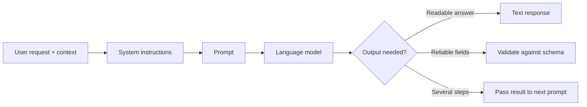
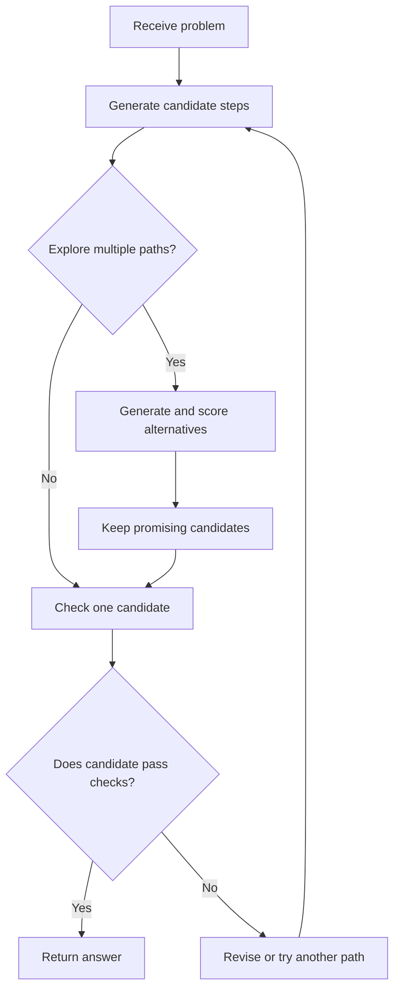
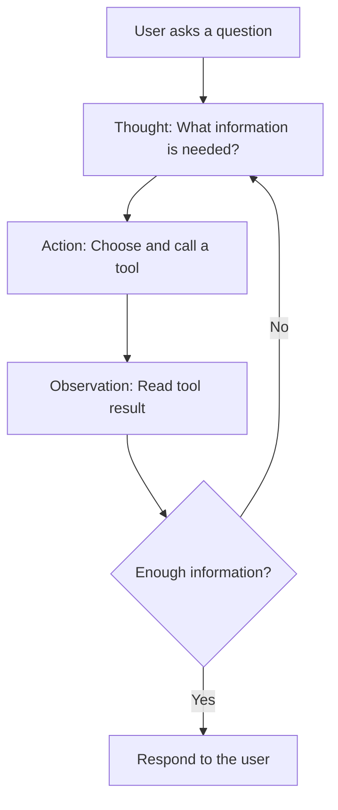
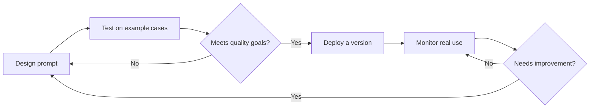

# Module 2.1 — Prompting as Programming

A prompt is more than a question: it’s a set of instructions that shapes how an AI agent behaves. Think of it like a small program written in everyday language. Clear instructions make the agent’s output more useful and predictable.

## Prompt design principles

A good prompt gives the agent four things:

- **Clarity:** Say exactly what you want.
- **Specificity:** Define the audience, format, or level of detail.
- **Constraints:** Set boundaries, such as a word limit or “use only the provided text.”
- **Context:** Provide the information the agent needs to do the task.

For example, “Tell me about Paris” is vague. This prompt is more useful:

> Explain Paris to a first-time visitor in three short bullet points. Include one famous landmark and one practical travel tip. Don’t include hotel recommendations.

The second prompt is clearer because it specifies the audience, format, required details, and an exclusion.

## System prompts: the agent’s standing instructions

A **system prompt** sets the agent’s role and general rules. It is like a job description and policy guide that applies across the conversation. A **user prompt** gives the specific task.

```python
from langchain_core.prompts import ChatPromptTemplate

prompt = ChatPromptTemplate.from_messages([
    ("system", """
You are a friendly travel guide.
Use plain language.
If you are unsure about a fact, say so.
"""),
    ("human", "Suggest a one-day plan for visiting Paris.")
])
```

The system message defines *how the agent should behave*; the human message says *what to do now*. System instructions guide the agent, but they don’t guarantee perfect results—important outputs still need checking.

## Structured outputs: ask for data, not just prose

Sometimes an application needs predictable fields rather than a paragraph—for example, a support ticket category and priority. A schema describes the expected shape, much like a form with named fields and allowed values.

```python
from pydantic import BaseModel, Field
from typing import Literal
from langchain_openai import ChatOpenAI

class Ticket(BaseModel):
    category: Literal["billing", "technical", "account"]
    priority: Literal["low", "medium", "high"]
    summary: str = Field(description="A short summary of the issue")

llm = ChatOpenAI(model="your-model")
ticket_parser = llm.with_structured_output(Ticket)

ticket_prompt = ChatPromptTemplate.from_messages([
    ("system", "Classify the support request using the given ticket fields."),
    ("human", "{request}")
])

ticket_chain = ticket_prompt | ticket_parser
result = ticket_chain.invoke({
    "request": "I was charged twice for my subscription."
})

print(result.category)  # billing
print(result.priority)  # high or medium, depending on the model's judgment
```

The schema acts as a **contract**: the application expects particular fields and types. Structured output is useful when your code needs to validate, store, or route the result. For actions such as calling an API, use a tool or function interface with defined inputs; the agent can then provide arguments in the shape that tool expects.

## Prompt chaining: solve a task in steps

A long task can be easier to manage as several smaller prompts. Each step’s output becomes the next step’s input—like an assembly line.

```python
from langchain_core.output_parsers import StrOutputParser

summarize = ChatPromptTemplate.from_messages([
    ("system", "Summarize the text in two sentences."),
    ("human", "{text}")
])

make_title = ChatPromptTemplate.from_messages([
    ("system", "Write a clear, short title for this summary."),
    ("human", "{summary}")
])

llm = ChatOpenAI(model="your-model")
summary_chain = summarize | llm | StrOutputParser()
title_chain = make_title | llm | StrOutputParser()

summary = summary_chain.invoke({"text": article_text})
title = title_chain.invoke({"summary": summary})
```

Chaining can make each step easier to understand and test. But every step depends on the information passed to it: if the first step leaves out an important detail, later steps may not recover it.



**Key takeaway:** Treat prompts like instructions for a program: make the goal clear, give relevant context, define constraints, and specify the output your application needs.

---
# Module 2.2 — Advanced Reasoning Strategies

When a task is tricky, one prompt may not be enough. Advanced reasoning strategies help an agent break work into steps, compare possible answers, and check its result—rather than rushing to its first guess.

A useful rule: ask for **steps, checks, or a brief explanation**, not necessarily a long internal monologue. For example, “List the assumptions and give a one-sentence justification” can make an answer easier to verify.

## Chain of Thought (CoT): work through a problem in steps

CoT prompting encourages the model to tackle a problem step by step.

Suppose we ask: “A notebook costs $4. How much do 7 notebooks cost?” A prompt might say:

> Identify the price per notebook and the number of notebooks. Calculate the total, then give the answer with a short explanation.

Common approaches:

- **Zero-shot CoT:** Ask for steps without giving examples: “Work through the calculation and check the result.”
- **Few-shot CoT:** Show examples of similar problems and their solutions first.
- **Guided CoT:** Provide a specific procedure, such as “identify the quantities, choose an operation, calculate, and verify.”

Guided steps are especially useful when you want the agent to follow a repeatable process. For more consequential tasks, validate the result with code or another trusted source.

## Self-consistency: compare several answers

A model can make different guesses when it generates multiple answers to the same question. **Self-consistency** samples several responses and chooses the most common answer.

For example, ask the model to solve a puzzle five times, collect the final answers, then choose the one that appears most often. This can reduce the effect of one unusual answer—but it does not guarantee correctness. If the samples share the same mistaken assumption, voting may reinforce the mistake.

```python
from collections import Counter

question = "A notebook costs $4. How much do 7 notebooks cost?"

answers = [
    ask_model(question),
    ask_model(question),
    ask_model(question),
]

most_common_answer, votes = Counter(answers).most_common(1)[0]
print(most_common_answer, votes)
```

In a real application, normalize answers before counting—for example, treat “$28” and “28 dollars” as equivalent.

## Tree of Thoughts (ToT): explore possible paths

CoT follows one path through a problem. **Tree of Thoughts** explores multiple possible paths, evaluates them, and continues with promising ones. Imagine planning a trip: you consider several routes, rule out impractical ones, and explore the best candidates further.

Search patterns describe how the agent explores:

- **Breadth-first:** Explore many options a little at a time.
- **Depth-first:** Follow one option deeply before trying another.
- **Beam search:** Keep only the best few options at each step, balancing exploration and efficiency.

More exploration can help with puzzles or planning, but it usually costs more time and model calls.

## Deliberate reasoning: check and revise

Deliberate reasoning adds a review loop:

1. Draft a candidate answer.
2. Check it against the task and any constraints.
3. If it fails, revise or try an alternative.
4. Return the checked result.

For instance, an agent generating a schedule could check for overlapping meetings and retry if it finds a conflict. In a LangGraph workflow, these stages can be represented as nodes connected by conditional edges: the check either leads to the final answer or loops back for revision.



**Key takeaway:** Use step-by-step guidance for a clear process, self-consistency to compare independent answers, and tree search when there are multiple paths to explore. Add a check when correctness matters—and remember that extra reasoning can increase cost without guaranteeing a better answer.
---
# Module 2.3 — The ReAct Framework

**ReAct** stands for **Reason + Act**. It’s a pattern for agents that need to use tools—such as search, a calculator, or a database—to answer a question. Instead of guessing from memory, the agent plans a next step, uses a tool, observes the result, and decides what to do next.

Imagine asking: “What’s the weather in Boston, and should I bring an umbrella?” The agent needs current weather data before it can make a useful recommendation.

## The ReAct loop

- **Thought:** Identify what information is missing and choose a next step.
- **Action:** Select and call an appropriate tool.
- **Observation:** Read the tool’s result and update the plan.



A simplified example:

```text
Question: Should I bring an umbrella in Boston today?

Thought: I need today's Boston forecast.
Action: Call the weather tool for Boston.
Observation: Rain is forecast this afternoon.

Thought: The forecast indicates rain, so an umbrella is sensible.
Response: Yes—bring an umbrella; rain is forecast this afternoon.
```

The agent shouldn’t claim the weather result until it has actually received it from the tool.

## Tool selection and execution

Tools let an agent interact with external systems. A tool might accept a city name and return forecast data. The agent should choose the tool that matches the task, provide valid inputs, and base its answer on the tool’s actual response.

In LangChain, tools can be defined for an agent to call. In LangGraph, the workflow can represent the agent, tool execution, and decision to continue or finish as separate nodes. This makes the loop easier to control and inspect.

## Advanced ReAct patterns

- **Reflexion:** After acting, the agent reviews what went well or poorly and uses that feedback to improve a later attempt.
- **Self-correction:** The agent checks its result against requirements and fixes detected mistakes—for example, retrying a tool call when required input is missing.
- **Recursive ReAct:** The agent applies the same think–act–observe process to smaller subtasks before returning to the main task.

These patterns can make an agent more robust, but they also add tool calls and complexity. Set sensible limits on retries and tool use, and surface errors when an action fails rather than pretending it succeeded.

**Key takeaway:** ReAct connects a model’s planning with real tool use. The agent decides what to do, acts, checks what happened, and repeats only when it needs more information.
---
# Module 2.4 — Prompt Management & Evaluation

A prompt that works in a demo may behave differently with real users. **Prompt management** treats prompts as part of your application: you design them, test them, deploy them carefully, and monitor their results.

## The prompt lifecycle

1. **Design:** Write the prompt with a clear task, context, constraints, and output format.
2. **Test:** Try it against representative examples, including tricky or invalid inputs.
3. **Deploy:** Release the prompt version to users or to a limited group first.
4. **Monitor:** Track quality, cost, speed, and user feedback. Revise when results decline.



## Version control: know what changed

Store prompts in version control, just like code. Give each meaningful change a version or commit, and keep track of the tests and results associated with it. If a new prompt causes problems, you can compare it with the previous version and roll back.

For example, a prompt update might change the output from free-form text to a required JSON structure. Record the change and test that the application can still parse the response.

## Experimentation: compare prompt versions

**A/B testing** compares two versions—for example, Prompt A and Prompt B—on similar requests. You might compare answer accuracy or user satisfaction.

**Multivariate testing** compares combinations of multiple changes, such as different instructions *and* different output formats. It can reveal which combination works best, but it usually needs more test cases to draw useful conclusions.

Keep the comparison fair: use similar inputs and the same evaluation method for each version.

## Evaluation metrics: define “better”

Useful measurements include:

- **Accuracy:** How often is the answer correct?
- **Hallucination rate:** How often does it state unsupported information?
- **Cost:** How much does each request cost to process?
- **Latency:** How long does a response take?
- **User satisfaction:** Do users find the result helpful?

No single metric tells the whole story. For example, a shorter response time isn’t an improvement if accuracy drops. Choose measures that reflect the task, and review a sample of outputs—not only aggregate scores.

**Key takeaway:** Manage prompts as versioned, testable parts of your application. Compare changes against clear quality goals, then monitor the results after deployment.
---
