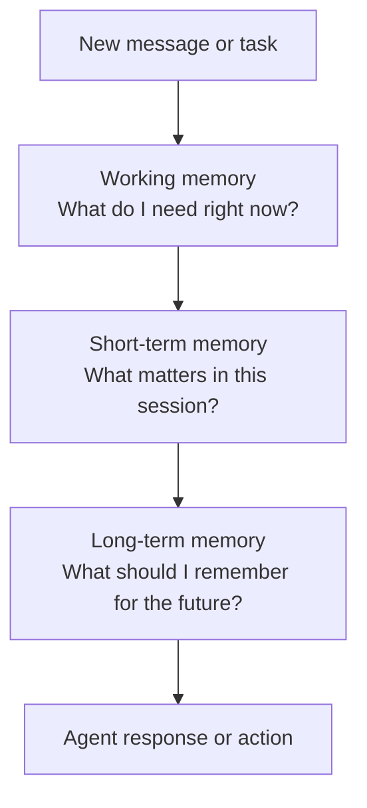
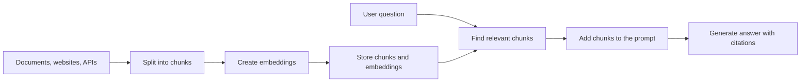
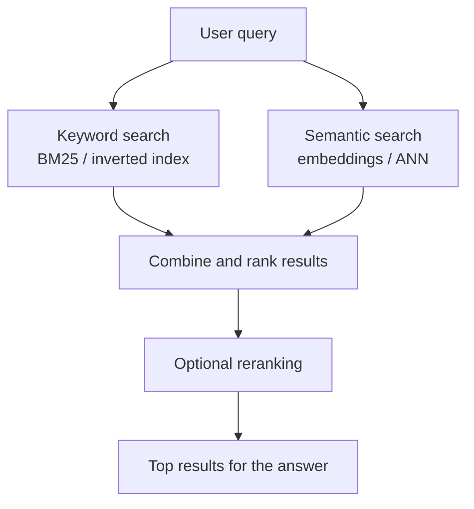
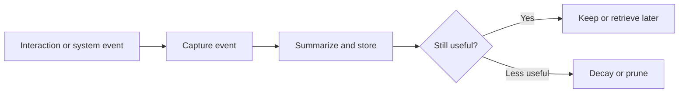
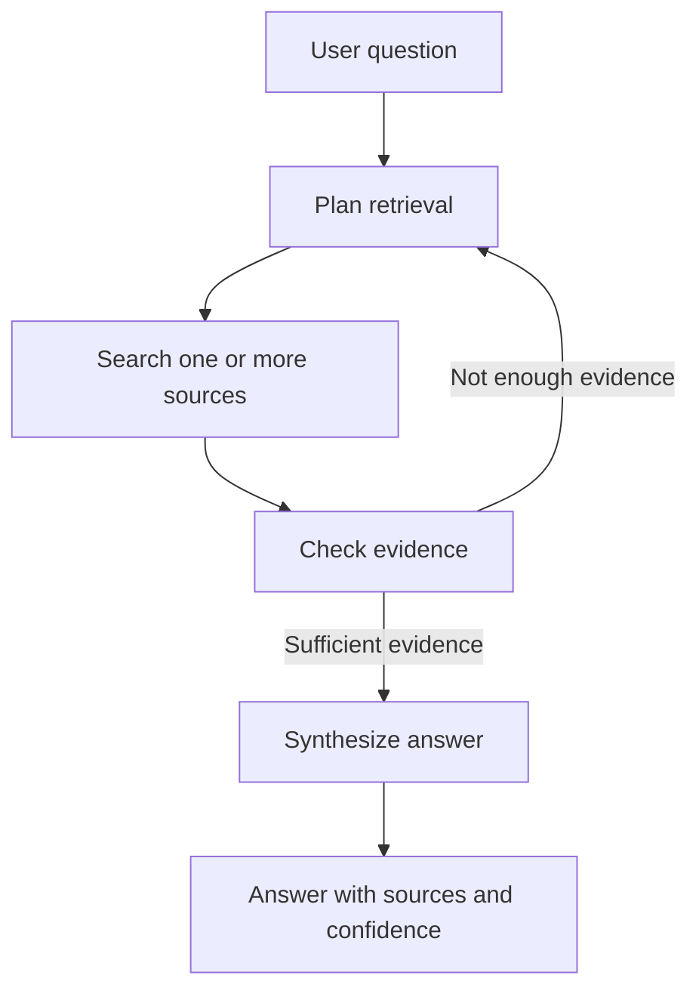

# Module 3.1: Layers of Agent Memory

An AI agent’s memory is like a person’s: some information is needed **right now**, some is useful for the **current conversation**, and some should be kept for **later**.

These layers help an agent decide what to remember, where to store it, and when to use it.



## Working memory

**Working memory** holds information the agent needs while completing its current task. It is temporary and focused on the present.

- **Context buffer:** Recent messages or task details kept available to the model.
- **Scratchpad:** A temporary space for intermediate notes, calculations, or steps.

**Example:** You ask, “Compare these three laptops and recommend one.” The agent keeps their prices, specifications, and your priorities in working memory while it compares them.

A scratchpad might contain:

```text
Priority: long battery life
Laptop A: $900, 12 hours
Laptop B: $800, 8 hours
Laptop C: $1,000, 14 hours
```

The scratchpad helps the agent reason through the comparison; it is not necessarily information to save permanently.

## Short-term memory

**Short-term memory** keeps useful information for the duration of a conversation or session. It helps the agent stay consistent across multiple turns.

- **Session memory:** Information associated with the current session.
- **Chat state:** The current topic, decisions, and details the conversation has established.

**Example:**

1. You say, “I’m planning a trip to Kyoto.”
2. Later, you ask, “What should I pack?”
3. The agent uses the trip context instead of asking where you’re going.

Short-term memory should be limited to what is useful for the active session. When the session ends, it may be cleared or summarized.

## Long-term memory

**Long-term memory** stores information that may be useful across future sessions.

- **Knowledge repositories:** Documents, manuals, or other reference material the agent can search.
- **Persistent user memory:** Useful preferences or facts the agent is permitted to retain, such as “prefers vegetarian recipes.”

**Example:** If the agent remembers that you prefer Python examples, it can use Python in a later conversation without you repeating the preference.

Long-term memory needs care: the agent should save relevant information appropriately, avoid retaining unnecessary personal details, and use stored information only when it applies.

## Comparing the layers

| Layer | Main purpose | Typical lifetime | Example |
|---|---|---|---|
| Working memory | Complete the task at hand | A task or model call | Notes for comparing laptops |
| Short-term memory | Follow the current conversation | One session | Destination for the trip |
| Long-term memory | Support future tasks | Across sessions | Preference for Python examples |

## Memory architectures

These layers describe **what memory is for**. An architecture describes **how memory is organized and stored**.

- **Single-store:** One storage system holds the agent’s memories. It is simple to build, but different kinds of information may be harder to manage separately.
- **Hybrid-store:** Multiple kinds of storage work together—for example, recent chat history plus a searchable document index.
- **Distributed memory:** Memory is spread across multiple systems or services. This can scale well, but requires coordinating access and keeping information consistent.

For example, a travel assistant might use a hybrid setup: the active conversation for short-term memory, and a document search system for long-term travel guides.

**Key idea:** Working memory helps the agent think through the current task; short-term memory keeps the conversation coherent; long-term memory helps across conversations.
---
# Module 3.2: Core RAG Pipeline

**RAG** stands for **Retrieval-Augmented Generation**. It lets an AI answer using relevant information retrieved from your own documents or data, rather than relying only on what it learned during training.

Think of it as an open-book exam: first find the useful pages, then answer using them.



## 1. Data ingestion

**Ingestion** means bringing information into the system.

Sources might include:

- Documents such as PDFs or Word files
- Website pages
- API responses, such as product or support data

For example, a support assistant might ingest product manuals and troubleshooting articles. It can also keep metadata—such as the document title or page number—so it can identify where retrieved information came from.

## 2. Chunking

Large documents are split into smaller pieces called **chunks**. This makes it easier to find only the parts relevant to a question.

- **Fixed-size chunking:** Split text into pieces of roughly the same length. Simple, but it may cut off an idea mid-sentence.
- **Semantic chunking:** Split where the meaning changes, such as between topics. This can preserve context, but takes more effort.
- **Recursive chunking:** Try natural boundaries first—like paragraphs or headings—and split further only when a piece is still too large.

Chunks may overlap a little so important context near a boundary is not lost.

## 3. Embeddings

An **embedding** turns text into a list of numbers that represents its meaning. Texts with related meanings tend to have embeddings that are close together.

For example, a system might recognize that these are related:

- “How do I reset my password?”
- “I can’t sign in—how can I change my credentials?”

- **Dense embeddings** represent meaning using learned numerical vectors.
- **Sparse embeddings** represent text using weighted terms, which can be useful for matching exact words.
- **Hybrid embeddings or retrieval** combine semantic matching with keyword matching.

## 4. Vector storage

The system stores chunks and their embeddings so it can search for relevant information later. Common choices include **FAISS**, **Pinecone**, **Chroma**, and **Weaviate**.

Some tools run locally; others provide managed database services. They differ in deployment, scaling, and features, so the right choice depends on the application.

## 5. Retrieval

When a user asks a question, retrieval finds chunks that may help answer it.

- **Similarity search** finds chunks whose embeddings are close to the question’s embedding.
- **ANN indexing** uses approximate nearest-neighbor techniques to search large collections faster.
- **Metadata filtering** narrows the search—for example, to a particular product manual or document date.

Retrieval returns *candidate evidence*, not a guaranteed correct answer. The agent still needs to use that evidence carefully.

## 6. Generation

The system adds the retrieved chunks to the prompt as context. The language model then uses the question and context to write an answer.

For example:

> **Question:** How long is the device warranty?  
> **Retrieved text:** “The device includes a two-year limited warranty.”  
> **Answer:** “The device has a two-year limited warranty.”  
> **Citation:** Product Guide, “Warranty” section

Preserving source information during ingestion makes citations possible. The answer should not claim a source supports something it does not say.

## A small Python-style example

This illustrates the pipeline; exact APIs vary between LangChain versions and integrations:

```python
documents = load_documents("product-manuals/")
chunks = split_documents(documents)
index = create_vector_store(chunks)

question = "How long is the device warranty?"
evidence = index.search(question, top_k=3)
answer = generate_answer(question, context=evidence, include_sources=True)
```

In a LangGraph agent, these steps could be separate nodes: **load or access data**, **retrieve evidence**, and **generate an answer**. The graph can then decide whether the evidence is sufficient or whether it should search again.

**Key idea:** RAG prepares searchable information ahead of time, retrieves useful pieces for each question, and gives those pieces to the model as evidence for its answer.
---
# Module 3.3: Vector Databases & Hybrid Search

A search system needs to find useful information among many documents. **Keyword search** looks for matching words, while **semantic search** looks for matching meaning. **Hybrid search** combines both.

## Keyword search

Keyword search is good when the exact terms matter—for example, finding an error code like `E104`.

- **Inverted index:** A lookup table mapping each word to the documents containing it.
- **BM25:** A ranking method that scores documents based on matching terms, taking into account how often terms appear and how long each document is.

**Example:** Searching for “E104” should prioritize documents that contain that exact code.

## Semantic search

Semantic search uses embeddings to find text with similar meaning, even when it uses different words.

**Example:** A search for “I forgot my login details” might find a guide titled “Reset your password.”

For larger collections, systems often use **approximate nearest neighbor (ANN)** indexes. These trade a small amount of exactness for faster searches.

## Hybrid search

Hybrid search combines keyword and semantic results. A simple approach is to give each result a combined score:

```text
combined score = 0.6 × keyword score + 0.4 × semantic score
```

The weights are examples, not universal defaults. The best balance depends on the data and what users search for.



## Reranking

Initial search is designed to find promising candidates quickly. **Reranking** takes those candidates and sorts them more carefully for the specific query.

- **Cross-encoder:** Evaluates a query and a candidate passage together to estimate how relevant the passage is. It can be more precise, but is usually slower than initial retrieval.
- **LLM reranker:** Uses a language model to judge or order candidate passages. It is flexible, but needs careful prompting and may cost more.

A common pattern is: retrieve a larger set quickly, rerank it, then give only the strongest results to the answer-generation step.

## Example

Suppose a user asks: **“What does error E104 mean, and how do I fix it?”**

1. Keyword search finds documents containing the exact code `E104`.
2. Semantic search finds troubleshooting instructions that discuss the same issue in different wording.
3. Hybrid search combines those candidates.
4. A reranker moves the most relevant explanation and fix to the top.
5. The agent answers using the retrieved sources.

**Key idea:** Keyword search is strong at exact matches; semantic search is strong at meaning. Hybrid search uses both, and reranking can improve the final ordering.
---
# Module 3.4: Episodic Memory

**Episodic memory** is a record of things that happened: user interactions, agent decisions, or system operations. It helps an agent learn from past events and use relevant experience later.

**Example:** A travel assistant records that it searched for accessible hotels, the user rejected two options, and the user preferred places near public transit. Later, it can use that history to make better suggestions.



## Event capture

Event capture records what happened, ideally with enough context to make it useful later:

- **User interactions:** Questions, preferences, corrections, or decisions.
- **System operations:** Tools called, tasks completed, and whether they succeeded.

A useful record might include the event, its time, and relevant context. Capturing *everything* is usually unnecessary; it increases storage and may retain details that should not be kept.

## Memory management

As episodes accumulate, the agent needs to keep memory useful and manageable.

### Decay

Older or less reliable memories can become less important over time.

- **Time-based forgetting:** Reduce the priority of memories that have not been used recently.
- **Confidence reduction:** Lower confidence in information that may be uncertain or outdated.

Decay does not have to mean immediate deletion. It can simply make a memory less likely to be retrieved.

### Summarization

Summarization turns many detailed events into a shorter, useful description.

For example, several hotel searches could be summarized as:

> “The user prefers accessible hotels near public transit.”

This is **compression**—using fewer words—and **knowledge distillation**—preserving the useful pattern while dropping incidental details.

### Pruning

Pruning removes memories that no longer earn their place.

- **Redundancy removal:** Merge or remove repeated information.
- **Cost optimization:** Keep storage and retrieval manageable by removing low-value records.

Pruning should be cautious: deleting a detailed episode may also remove context needed to interpret a summary.

**Key idea:** Episodic memory records past events, then manages them so useful experience can help the agent without letting memory grow endlessly.
---
# Module 3.5: Agentic RAG

**Agentic RAG** combines retrieval with an agent that can decide *how* to search, whether it has enough evidence, and what to do next.

A basic RAG pipeline usually retrieves information once. An agentic RAG system can plan several searches, check sources, and refine its answer.



## Retrieval planning

The agent can prepare a better search strategy before retrieving information.

- **Query rewriting:** Rephrase a question into search-friendly queries. For “Can I use this outdoors?”, the agent might search for “outdoor use,” “weather resistance,” and “operating temperature.”
- **Multi-hop retrieval:** Search in stages when one result helps identify what to search for next.

**Example:** To answer “Who leads the company that made this device?”, the agent first identifies the manufacturer from a product document, then searches for the company’s current leader.

## Autonomous verification

After retrieving information, the agent can check whether it is supported and consistent.

- **Cross-source validation:** Compare relevant claims from multiple sources.
- **Fact checking:** Check whether the source actually supports the claim in the proposed answer.

If sources conflict or do not provide enough evidence, a careful agent should say so or search again—not present a guess as a fact.

## Research agents

A research agent can work through a question in stages:

1. **Collect sources** relevant to the question.
2. **Synthesize** their information into a clear response.
3. **Score confidence** based on how relevant, reliable, and consistent the evidence is.

A confidence score is an estimate, not proof that an answer is correct. The agent should still show supporting sources when possible.

**Key idea:** Agentic RAG turns retrieval into an iterative research process: plan searches, gather evidence, verify it, and answer only when the evidence is adequate.
---