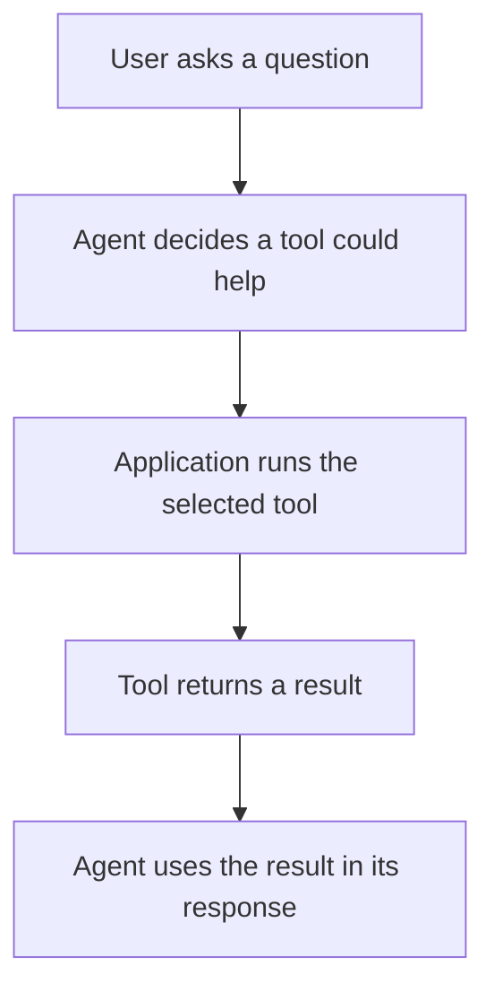
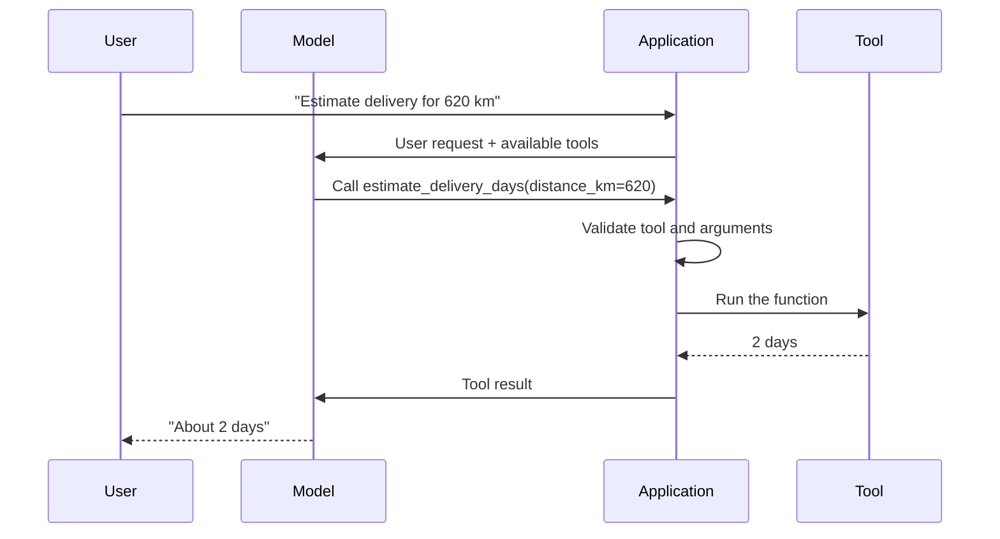
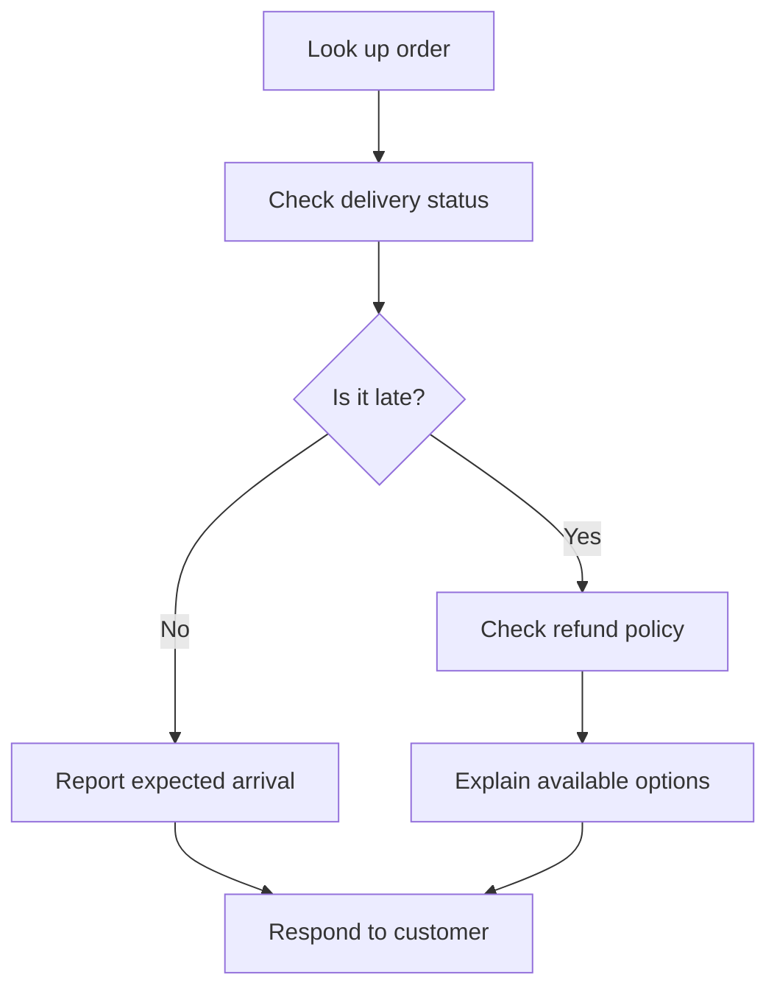
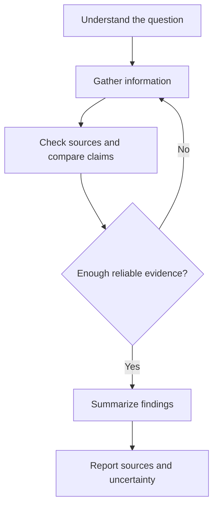

## Module 4.1: Tool Usage Fundamentals

A language model can **reason and suggest what to do**, but it can’t directly fetch live data, query your database, or run code. A **tool** is a function the agent can ask the surrounding application to run. The application returns the result, and the agent can use it in its reply.

Think of a tool like an assistant’s hands: the model decides *what it needs*, while your program controls *what actually runs*.

### Common kinds of tools

| Tool | What it does | Example |
|---|---|---|
| **API** | Talks to another service | Check a delivery status |
| **Database** | Reads or updates stored information | Look up a customer’s order |
| **Search** | Finds information in documents or the web | Search a company knowledge base |
| **Execution** | Runs a limited operation | Calculate a total |
| **Custom** | Performs an action specific to your app | Create a support ticket |

### A small Python example

LangChain’s `@tool` decorator turns a Python function into a tool. Its name and description help an agent understand when it might be useful.

```python
from langchain_core.tools import tool

@tool
def estimate_delivery_days(distance_km: float) -> int:
    """Estimate delivery time in days for a distance in kilometers."""
    if distance_km < 0:
        raise ValueError("Distance must be non-negative.")

    return max(1, round(distance_km / 300))
```

For example, the application can run the tool with `estimate_delivery_days.invoke({"distance_km": 620})`, which returns `2`. An agent might use this when asked, “About how long will delivery take for a 620 km trip?”

The function’s description matters: “Estimate delivery time…” gives the agent a better clue than a vague name like `calculate`.

### Typical flow



**Important:** The model does not run the Python function by itself. Your application executes it. That boundary lets you validate inputs, limit permissions, and require approval before sensitive actions. For instance, a delivery estimate can run automatically, while issuing a refund should usually require authorization.

This covers the fundamentals of tool usage.
---
## Module 4.2: Function Calling

**Function calling** is how an agent asks your application to run a tool. The model chooses a tool and proposes its arguments; your application validates the request, runs the function, and sends the result back. The model doesn’t execute the function itself.

### 1. Describe a tool with a schema

A JSON schema tells the model what the tool does and what arguments it expects:

```json
{
  "name": "estimate_delivery_days",
  "description": "Estimate delivery time for a shipment.",
  "parameters": {
    "type": "object",
    "properties": {
      "distance_km": {
        "type": "number",
        "description": "Shipment distance in kilometers"
      }
    },
    "required": ["distance_km"],
    "additionalProperties": false
  }
}
```

The schema helps the model produce structured arguments, such as:

```json
{"distance_km": 620}
```

It does **not** replace validation in your application. Check the value before running the tool—for example, reject a negative distance.

### 2. Follow the tool lifecycle



The model’s choice is a **request**, not permission to do anything. Your application decides which tools are available and whether to run them. In LangChain, a function decorated with `@tool` can provide the tool name, description, and argument schema; the agent framework handles much of the calling flow.

### 3. Retry carefully

Retries can help with temporary failures, like a brief network timeout. Use a small retry limit and increasing delays between attempts. Don’t keep retrying invalid arguments or permission errors—they won’t improve on their own.

Be especially careful with actions that change data. If a payment or ticket creation times out, retrying could accidentally create it twice. Use an **idempotency key** or check whether the action already succeeded before trying again.

**In short:** schemas guide the model, your application validates and executes, and retries should distinguish temporary failures from permanent ones.
---
## Module 4.3: Tool Composition

**Tool composition** means connecting tools so they work together to complete a task. Instead of asking one tool to do everything, an agent can combine small tools—like steps in a recipe.

Imagine answering: “Is my order delayed, and what can I do about it?” The agent may look up the order, check its delivery status, then choose an appropriate response.

### Three common patterns

- **Sequential:** Run tools in order when one step depends on another. For example: look up an order → check its status.
- **Parallel:** Run independent tools at the same time. For example: fetch shipping details and read the refund policy.
- **Conditional:** Choose the next step based on a result. For example: if the order is late, check refund eligibility; otherwise, report its expected arrival.



### Expressing a conditional workflow in LangGraph

LangGraph connects Python functions as nodes in a graph. A conditional edge routes execution based on the shared state:

```python
from typing import TypedDict
from langgraph.graph import StateGraph, START, END

class State(TypedDict, total=False):
    order_id: str
    status: str
    reply: str

def lookup_order(state: State) -> State:
    # Replace with a real, authorized order lookup.
    return {"status": "delayed"}

def choose_path(state: State) -> str:
    return "late" if state.get("status") == "delayed" else "on_time"

def explain_delay(state: State) -> State:
    return {"reply": "Your order is delayed. I can check the available options."}

def explain_arrival(state: State) -> State:
    return {"reply": "Your order is on track."}

graph = StateGraph(State)
graph.add_node("lookup", lookup_order)
graph.add_node("delay_reply", explain_delay)
graph.add_node("arrival_reply", explain_arrival)

graph.add_edge(START, "lookup")
graph.add_conditional_edges(
    "lookup",
    choose_path,
    {"late": "delay_reply", "on_time": "arrival_reply"},
)
graph.add_edge("delay_reply", END)
graph.add_edge("arrival_reply", END)

app = graph.compile()
result = app.invoke({"order_id": "ORD-123"})
```

In a real application, `lookup_order` would call an API or database tool. The example uses a fixed result to keep the routing logic clear.

### Plan for errors, too

A composed workflow should decide what happens if a step fails. Retry temporary failures, such as a timeout, with a limit; route permanent failures, such as “order not found,” to a useful response. For actions that change data, prevent duplicate effects if a retry occurs.

**The key idea:** use sequence for dependencies, parallelism for independent work, and conditional routing for decisions.
---
## Module 4.4: Advanced Agent Archetypes

An **agent archetype** is a common kind of agent, shaped around a particular job. Each uses tools differently: a coding agent works with code, a research agent gathers evidence, and so on.

| Archetype | What it does | Simple example |
|---|---|---|
| **Coding agent** | Generates or refactors code, then runs tests | Add a date-formatting function, update its tests, and report the results |
| **Computer-use agent** | Interacts with a browser, files, or desktop apps | Open a webpage, find a form, and fill in a draft |
| **Research agent** | Gathers information, checks sources, and summarizes findings | Compare several product pages and cite the details found |
| **Business agent** | Uses business systems to automate workflows or analyze data | Find overdue CRM accounts and prepare follow-up drafts |

A coding agent should **test its changes** rather than assume the code works. A research agent should **verify claims against trustworthy sources**. A business agent should **respect access permissions** and avoid actions like sending messages or changing records without appropriate approval.

### A research-agent workflow



The archetype guides the workflow, but doesn’t guarantee a good result. Reliable agents need suitable tools, clear permissions, and checks suited to their task.
---