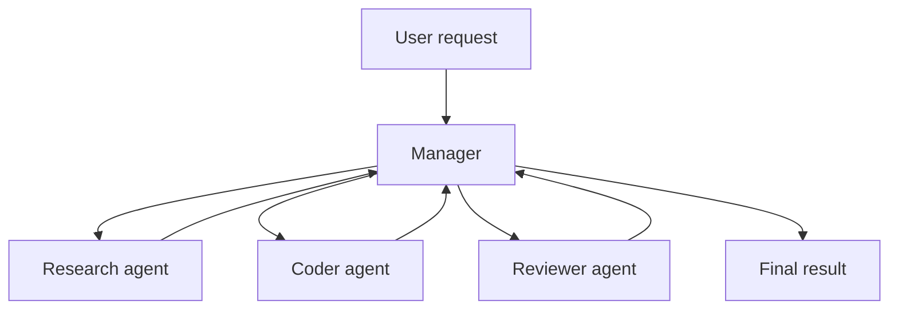
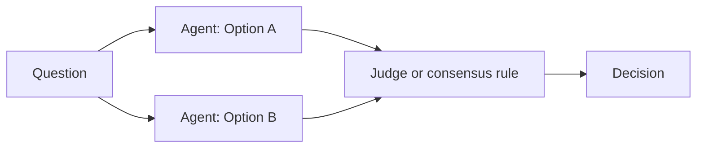
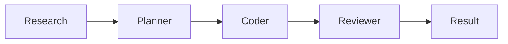
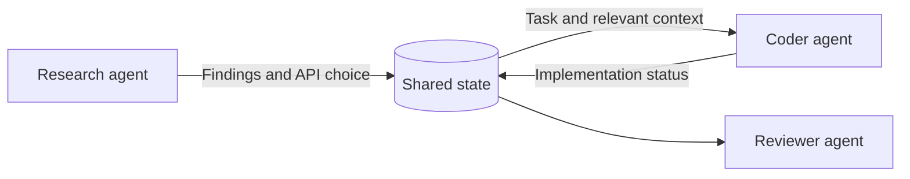
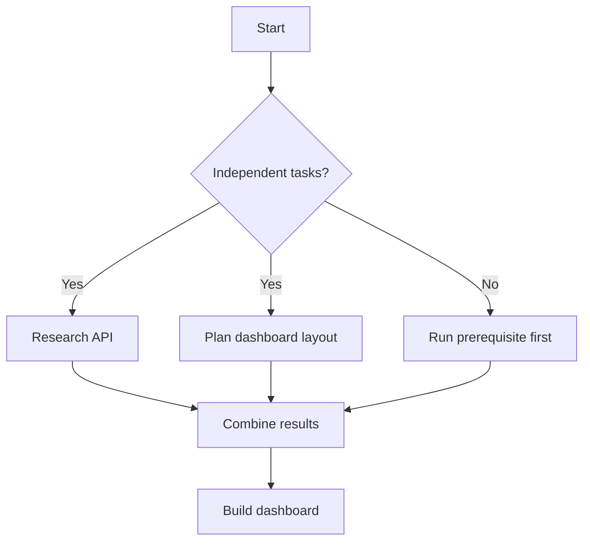
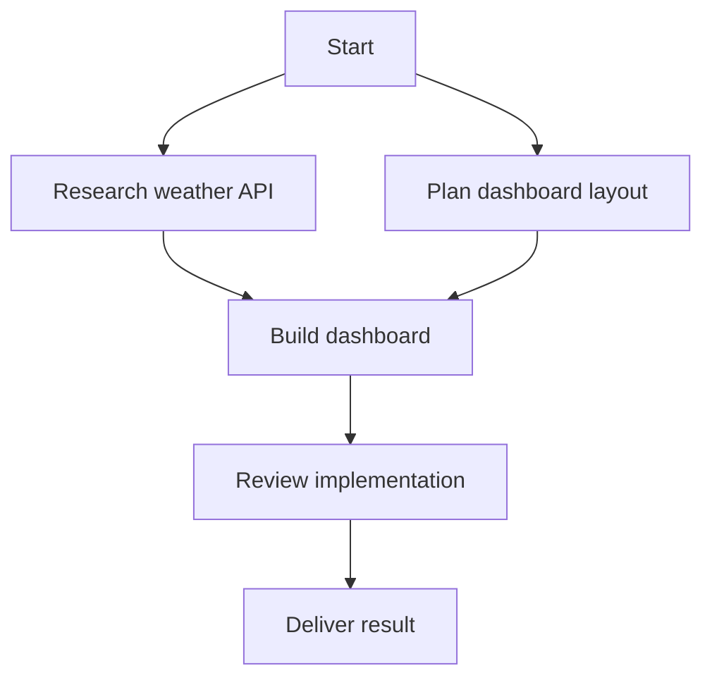
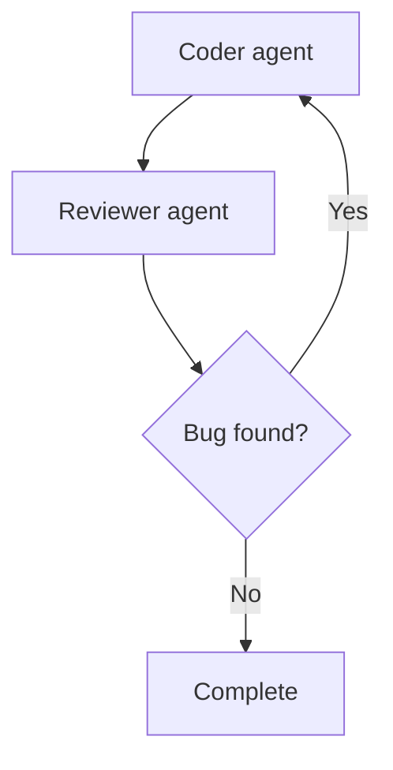
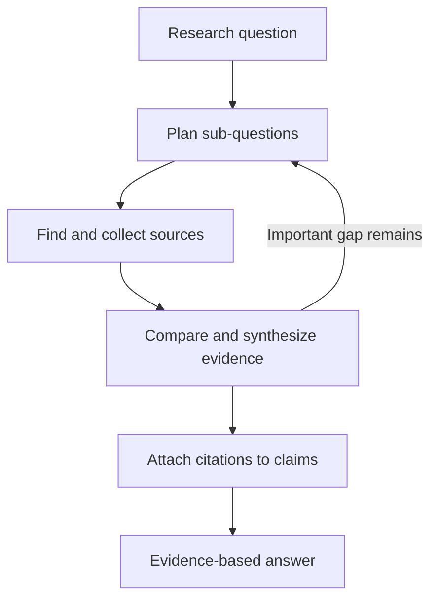

# Module 5.1: Agent Specialization

A multi-agent system is like a team: each agent has a **specific job**, and the system decides how they work together. Specialization helps because one agent focused on research, for example, may do better than a single agent trying to research, plan, code, and review all at once.

## Common specialist agents

Imagine a team building a weather dashboard:

| Agent | Main responsibility | Example task |
|---|---|---|
| **Planner** | Breaks a goal into steps | “We need weather data, a display, and tests.” |
| **Research** | Finds and summarizes information | “Which weather API provides the needed data?” |
| **Coder** | Implements a solution | “Write the code to fetch and display the forecast.” |
| **Reviewer** | Checks work for problems | “Does the code handle an API timeout?” |
| **Manager** | Assigns work and tracks progress | “Ask Research to compare APIs, then assign the chosen one to Coder.” |

These are **roles**, not necessarily separate programs. In a simple system, each role might be a different prompt or tool configuration.

## Multi-agent architectures

An architecture describes **how the agents work together**.

### Manager–Worker

A manager divides a large task into smaller tasks, delegates them, and combines the results.

**Example:** The Manager asks Research to compare weather APIs, asks Coder to build the dashboard using the selected API, and asks Reviewer to check the code.

**Useful when:** A task has clear parts and someone needs to coordinate them.

### Debate architecture

Two or more agents examine a question from different viewpoints. A judge, manager, or agreed rule then selects or combines their conclusions.

**Example:** One agent recommends storing weather data in a database; another argues that fetching it on demand is simpler. A reviewer compares their reasoning against the project’s needs.

Debate can reveal trade-offs, but **agreement alone does not guarantee correctness**. The system should check claims against evidence or requirements.

### Pipeline architecture

Agents process the task in a fixed sequence. Each agent passes its output to the next.

**Example:** Research finds the API, Planner defines the implementation steps, Coder writes the dashboard, and Reviewer checks it.

**Useful when:** The stages have a natural order and later steps depend on earlier results.

### Swarm architecture

Agents work more independently, often exploring different parts of a problem. Their findings are gathered and combined, sometimes with a coordinator.

**Example:** Several Research agents independently investigate API reliability, pricing, and data coverage; the team combines their findings.

**Useful when:** A problem is broad or has many independent avenues to explore. Without clear coordination, agents may duplicate effort or produce conflicting results.

## The key distinction

**Specialization is who does each job; architecture is how those jobs are arranged.** For example, a system can use specialist agents in a pipeline, or a Manager can delegate to specialists and then request a debate about competing solutions.

In LangGraph, agents and steps are commonly represented as **nodes**, and the connections between them as **edges**. A fixed pipeline uses straightforward edges; a manager-style system can use routing to choose which agent runs next.

---
# Module 5.2: Agent Communication

Agents need a way to **share information and hand off work**. Think of a team using a shared workspace, agreed message formats, and a schedule. Without those, agents may lose context, repeat work, or misunderstand what to do next.

## Communication protocols

A protocol is a set of rules for how software components exchange information.

- **MCP (Model Context Protocol)** lets an AI application connect to external tools and data sources through a standard interface. For example, an agent can use an MCP server to access a file system or query a database.
- **A2A (Agent-to-Agent)** is designed for agents to communicate and coordinate with other agents, such as discovering another agent’s capabilities and assigning it a task.
- **Message buses** are shared channels for sending messages. An agent posts a message; another agent or service can pick it up. This is useful when agents don’t need to respond immediately.

**Quick distinction:** MCP commonly connects an agent to tools or data; A2A supports communication between agents. A message bus is one possible way to deliver messages.

## Task handoffs

A handoff happens when one agent gives another agent a task and enough information to continue.

For example, a Research agent might hand work to a Coder agent:

> “Use the Open-Meteo API. It provides the forecast fields we need. Build a function that fetches the next 7 days. The API documentation is here: …”

The receiving agent needs both the **task** and relevant **context**—not the entire conversation history.

### Shared state and context passing

- **Shared state:** Agents read and update a common workspace, such as a task status, selected API, or research notes.
- **Context passing:** An agent includes the necessary details directly in its handoff message.

A well-formed handoff might include the goal, relevant findings, constraints, and expected output.

Shared state is useful when multiple agents need the same evolving information. Context passing is useful for a direct, focused handoff. Some systems use both.

## Coordination

Coordination determines **who works when** and **what resources they can use**.

- **Scheduling:** Run agents in order when one depends on another, or in parallel when tasks are independent.
- **Resource allocation:** Limit things like the number of agents running at once, tool access, time, or token budget.

For instance, researching API options and designing the dashboard layout can happen in parallel. Coding against the chosen API should wait until the research is complete.

In LangGraph, a workflow can pass state between nodes and choose whether to run steps sequentially, in parallel, or conditionally. The important part is to make each handoff explicit: **what is the next task, what context does it need, and where should its result go?**
---
# Module 5.3: Orchestrating Multi-Agent Teams

**Orchestration** is the process of deciding which agents work, in what order, and what happens with their results. It turns a collection of agents into a coordinated workflow.

## Workflow design

A **DAG** (directed acyclic graph) is a workflow map: arrows show what depends on what, and cycles are avoided so the workflow doesn’t loop forever.

For a weather dashboard, researching the API and planning the layout can happen at the same time. Coding can begin once both are done.

**Dynamic routing** means choosing the next step based on information available at runtime. For example, if the Reviewer finds a bug, send the work back to the Coder; otherwise, finish.

## Collaboration patterns

- **Sequential:** Agents work one after another. Use this when each step needs the previous step’s result—for example, Research → Code → Review.
- **Parallel:** Independent agents work at the same time. For example, one agent researches API options while another plans the interface.
- **Hierarchical:** A manager delegates tasks to agents, checks their results, and may delegate follow-up work.

These patterns can be combined: a manager might start parallel research, then send the combined findings through a sequential coding and review pipeline.

## Conflict resolution

Agents may disagree or produce incompatible results. Common ways to resolve that include:

- **Voting:** Choose the most-supported option. This works best when agents assess the same question using clear criteria.
- **Supervisor intervention:** A manager or reviewer compares the arguments with the requirements and makes a decision, or asks for more evidence.

**Example:** Two agents recommend different weather APIs. A supervisor checks which one meets the required data coverage and usage limits, then records the choice so the team can proceed consistently.

In LangGraph, orchestration is commonly represented by nodes for agents and workflow steps, with edges controlling transitions. Fixed edges define a predictable workflow; conditional edges support dynamic routing.
---
# Module 5.4: Deep Research Agent Pattern

A **Deep Research Agent** investigates a question in stages instead of answering from a quick search. It plans what to find, gathers sources, compares evidence, and connects claims to citations.

Imagine asking: **“How can urban trees reduce summer heat?”**

## Four phases

1. **Planning:** The agent breaks the question into smaller ones, such as “How do trees create shade?” and “How does vegetation affect local temperatures?”
2. **Browsing:** It searches for relevant sources and collects useful passages, links, and publication details.
3. **Synthesis:** It compares sources, looks for agreement or disagreement, and combines supported findings into a clear explanation.
4. **Citation:** It links each important claim to the source that supports it, so readers can check the evidence.

The loop matters: if the sources don’t answer an important sub-question, the agent can return to planning and search again.

## What makes the pattern useful?

A simple search may find a page that *mentions* the topic. Deep research asks whether the sources actually support the answer, whether they agree, and what limitations they have.

For example, the final answer might say that tree shade can reduce heat exposure for people, and cite a source for that claim. If another source measures neighborhood air temperature rather than personal heat exposure, the agent should keep those findings distinct rather than treating them as interchangeable.

**Good research keeps evidence attached to claims.** The agent should cite sources it actually consulted, avoid inventing references, and signal uncertainty when the evidence is limited or mixed.
---
