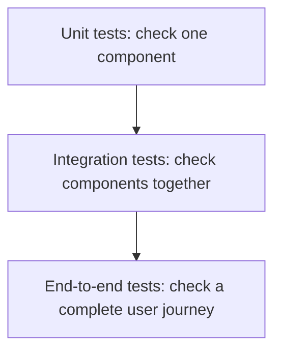
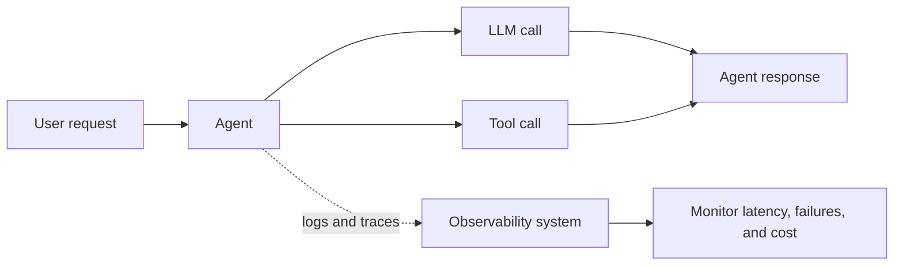
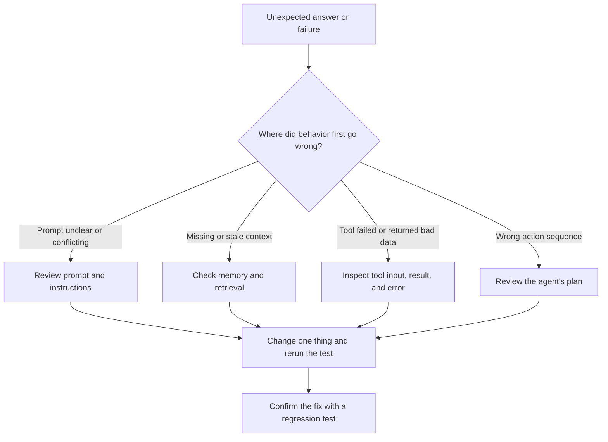
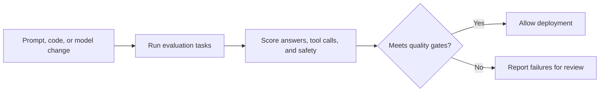

# Module 6.1 — Testing Frameworks

Think of testing an agent like checking a restaurant: **unit tests** taste individual ingredients, **integration tests** check whether the kitchen stations work together, and **end-to-end tests** follow a whole meal from order to delivery.



## Unit tests: check small pieces

Unit tests are fast, focused checks. They help pinpoint whether a problem is in a prompt, a tool, or state the agent remembers.

**Prompt test:** Check that a prompt contains the expected instructions and user input before sending it to a model.

```python
from langchain_core.prompts import ChatPromptTemplate

prompt = ChatPromptTemplate.from_messages([
    ("system", "Answer clearly and briefly."),
    ("human", "Question: {question}"),
])

messages = prompt.invoke({"question": "Why is the sky blue?"}).to_messages()

assert messages[0].content == "Answer clearly and briefly."
assert "Why is the sky blue?" in messages[1].content
```

This does not test whether the model gives a good answer; it checks that the prompt is assembled correctly.

**Tool test:** Check a tool’s behavior with a known input and expected output.

```python
from langchain_core.tools import tool

@tool
def add_numbers(a: int, b: int) -> int:
    """Add two numbers."""
    return a + b

def test_add_numbers():
    assert add_numbers.invoke({"a": 2, "b": 3}) == 5
```

When a tool calls an external service or database, mock that dependency so the test stays predictable and doesn’t rely on a network connection.

**Memory test:** Check that state is retained between turns. For example, a LangGraph checkpointer can restore a graph’s state for the same `thread_id`.

```python
from typing import TypedDict
from langgraph.checkpoint.memory import InMemorySaver
from langgraph.graph import END, START, StateGraph

class State(TypedDict, total=False):
    visits: int

def count_visit(state: State):
    return {"visits": state.get("visits", 0) + 1}

builder = StateGraph(State)
builder.add_node("count", count_visit)
builder.add_edge(START, "count")
builder.add_edge("count", END)

app = builder.compile(checkpointer=InMemorySaver())
config = {"configurable": {"thread_id": "test-conversation"}}

assert app.invoke({}, config)["visits"] == 1
assert app.invoke({}, config)["visits"] == 2
```

The shared `thread_id` lets the second call continue from the first call’s checkpoint. In production, the checkpointer may use persistent storage; this test uses an in-memory one.

## Integration tests: check components together

An integration test checks that connected pieces work as a group—for example, a prompt, model, and tool working in a tool-use chain, or two agents passing information correctly.

A useful approach is to keep external services mocked, but use the real prompt, graph, and tool wiring. That tests the connections without making the result depend on network availability or a live model’s changing responses.

## End-to-end tests: check the whole journey

An end-to-end (E2E) test follows a complete workflow, such as:

1. A user asks to check an order.
2. The agent identifies the order number.
3. It calls the order-lookup tool.
4. It returns a useful response.

E2E tests validate the workflow from the user’s perspective. They provide broad coverage, but tend to be slower and more sensitive to changes in models and external services. Use a controlled test environment and avoid relying on a model to produce one exact sentence.

## What should I test first?

Start with unit tests for important prompts and tools, then add integration tests for critical connections. Use E2E tests for the most important user journeys. This gives quick feedback on small problems while still checking that key workflows work as a whole.

In Python projects, `pytest` is a common choice for running these tests:

```bash
pytest
```

**Key idea:** A unit test asks, “Does this piece work?” An integration test asks, “Do these pieces work together?” An E2E test asks, “Can the user complete the task?”
---
# Module 6.2 — Observability

**Observability** helps you understand what an agent did, how long it took, where it failed, and what it cost. Think of it like a flight recorder: when a user reports a problem, you can inspect the journey instead of guessing.



## Logging: record useful events

Logs are timestamped notes about what happened. They can capture events such as “agent started,” “tool called,” or “request failed.”

```python
import logging

logging.basicConfig(level=logging.INFO)
logger = logging.getLogger("agent")

logger.info("Agent run started", extra={"run_id": "run-42"})
logger.info("Tool completed", extra={"tool_name": "order_lookup"})
```

Prompt and tool logs can help debug behavior, but they may contain personal data, credentials, or confidential text. **Redact sensitive values** and limit who can access logs. Often, recording a prompt template name or a safely shortened input is enough.

## Distributed tracing: follow one request across components

A **trace** connects the steps taken for one request. Each step—such as an LLM call or tool call—can be represented as a **span** with its duration and outcome.

For example, a trace might show that an agent request took 2.4 seconds total: 1.8 seconds waiting for the model and 0.4 seconds calling an order service. That makes a slow step easier to spot.

- **OpenTelemetry** provides standards and libraries for collecting traces and metrics across services.
- **LangSmith** provides tooling focused on inspecting and evaluating LangChain and LangGraph runs.

Choose a tracing setup that fits your stack, and avoid sending sensitive data to any observability service unless your data-handling requirements allow it.

## Monitoring: watch the agent’s health

Monitoring summarizes behavior over time, so you can spot problems before users report them. Useful measures include:

- **Latency:** How long requests take, including slow LLM or tool calls.
- **Failures:** How often a run or individual step errors.
- **Costs:** Token usage or other per-request costs.

For example, if tool failures suddenly rise after a deployment, monitoring can alert the team to investigate.

**In short:** logs explain individual events, traces connect the steps in a request, and monitoring shows trends across many requests. Together, they help you answer: *What happened, where, and how often?*
---
# Module 6.3 — Agent Debugging

Debugging an agent means finding **why** it gave a poor answer or failed—not just retrying until it works. A useful approach is to follow the request step by step: inspect the prompt, check the memory and retrieved context, then verify the tools and the agent’s plan.



## Root cause analysis

Start with the **first incorrect step**, not just the final response. If an agent gives the wrong order status, for example, the cause might be a malformed tool input—not the final answer itself.

- **Prompt issues:** Instructions may be vague, contradictory, or missing important constraints. Check what prompt the model actually received.
- **Memory issues:** The conversation may not have been saved or retrieved as expected. Check the thread or session identifier and the state available to the agent.
- **Tool failures:** A tool may have received invalid input, timed out, or returned unexpected data. Inspect its inputs, outputs, and errors.

Change one likely cause at a time, then rerun the relevant test. This makes it easier to tell whether the change fixed the problem.

## Common error categories

**Hallucinations** happen when an agent presents unsupported information as fact. Check whether the needed information was in the prompt or retrieved context. Consider asking the agent to cite its source or say when it does not know.

**Retrieval failures** happen when the agent does not find the information it needs. Check whether the right documents were indexed and whether the search returned relevant results.

**Planning failures** happen when the agent chooses the wrong steps or uses tools in the wrong order. Inspect the plan and tool sequence; make sure the agent has clear rules for when each tool is appropriate.

## A practical debugging loop

For a failed run, collect its input, relevant prompt and state, tool calls and results, and final output—while redacting sensitive data. Find the first incorrect step, make a focused change, and add a test so the same failure is less likely to return.

**Key idea:** Debug the agent’s process, not just its answer.
---
# Module 6.4 — Benchmarks & Automated Evaluation

A benchmark is a repeatable set of tasks used to measure how well an agent performs. Instead of asking “Does it seem better?”, you can compare results across versions and see what changed.

## What can a benchmark measure?

- **Reasoning:** Does the agent reach a correct answer from the information provided?
- **Tool use:** Does it choose the right tool and give it valid inputs?
- **Planning:** Does it complete multi-step tasks in a sensible order?
- **Safety:** Does it follow safety rules and avoid actions it should not take?

A benchmark might include a task like: “Look up order 1042 and report its delivery status.” You could check whether the agent called the order tool with the right ID and whether its final response matched the tool result.

## Automated evaluation pipelines

Evaluation pipelines run a chosen set of checks automatically—often in CI/CD when a change is proposed. They can catch regressions, such as a new prompt causing the agent to stop using a required tool.



A simple test can check a critical behavior:

```python
def test_order_question_uses_lookup_tool(agent):
    result = agent.invoke({"question": "Where is order 1042?"})

    assert "order_lookup" in result["tools_called"]
    assert "1042" in result["tool_inputs"]["order_lookup"]
```

The exact fields depend on how your agent records its run. The important part is to make the desired behavior measurable.

## Regression testing and quality gates

A **regression test** reruns tasks that worked before to check they still work after a change. A **quality gate** defines what must pass before deployment—for example, all critical tool-use tests pass, and the safety evaluation does not fall below an agreed threshold.

Not every evaluation should require an exact sentence match. Model responses can vary while still being correct. Prefer checks that match the requirement: expected facts, correct tool calls, valid output structure, or a reviewed safety criterion. For subjective answers, automated scoring can help flag cases, but human review may still be needed.

**Key idea:** Benchmarks make agent quality observable over time. Automated evaluations help catch regressions before users do.
---
