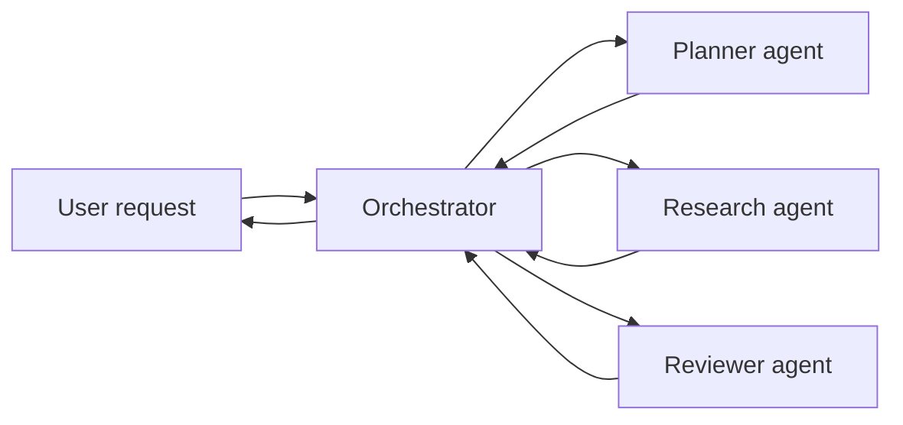
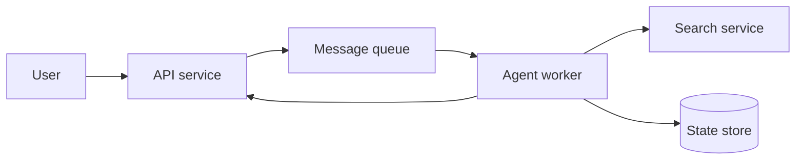
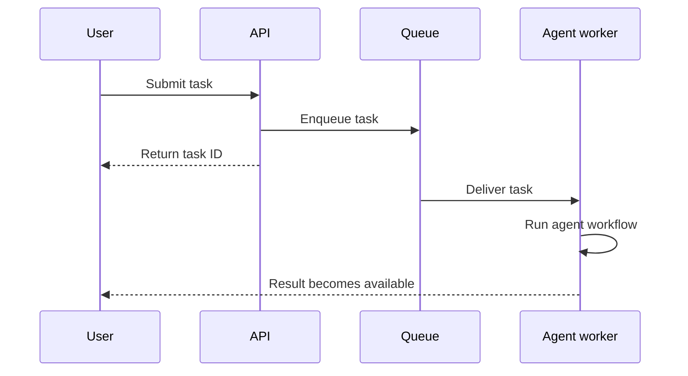
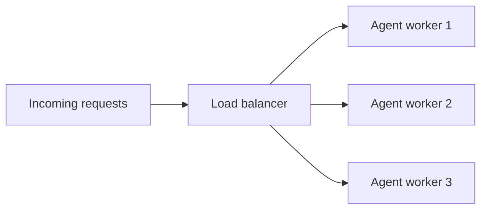
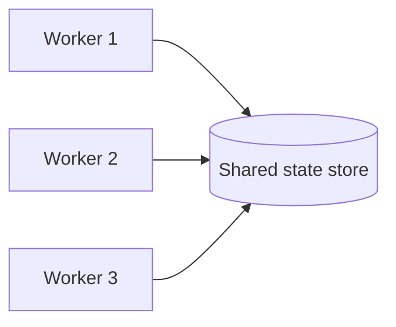
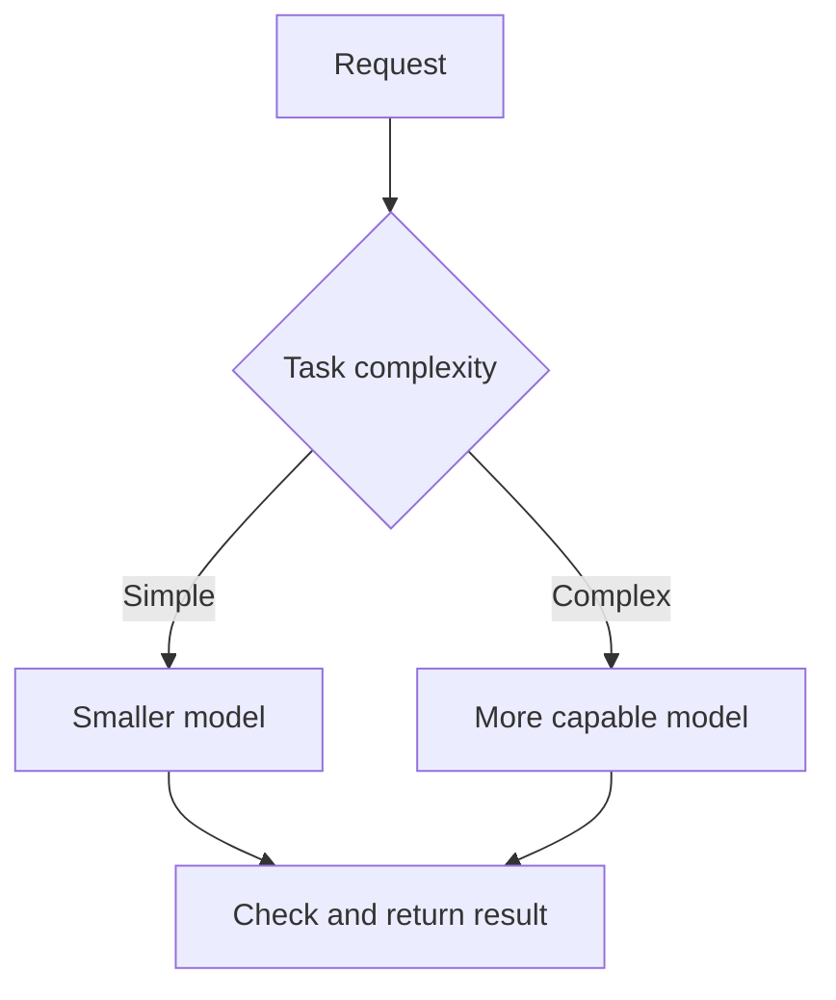
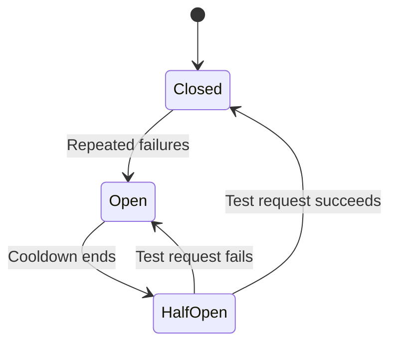
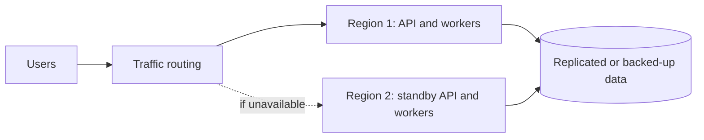
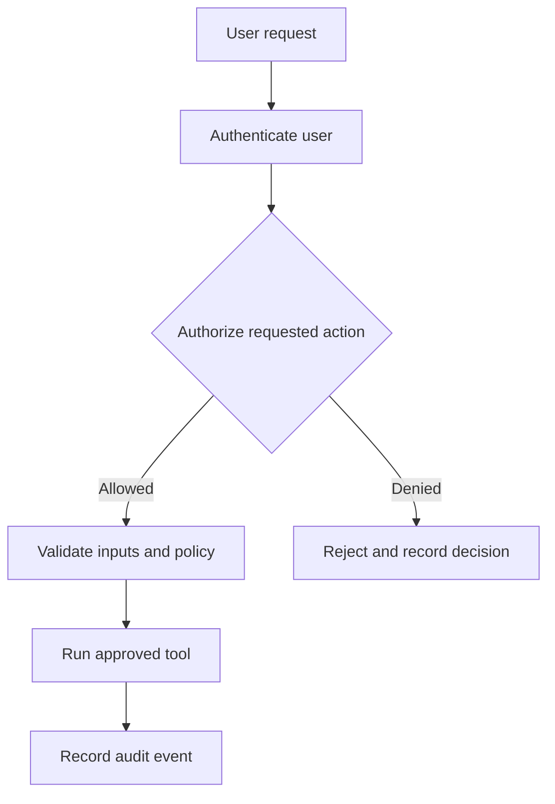
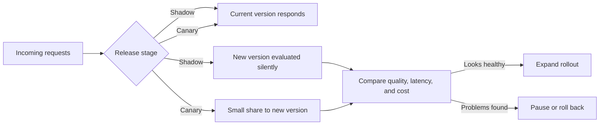

# Module 7.1: Production-Ready Architectures

A prototype agent often runs as one Python process on a developer’s machine. A production agent needs a reliable place to run, a way to handle incoming work, and a plan for what happens when requests increase or something fails.

Think of a restaurant: the **agent** is the cook, the **deployment pattern** is the kitchen layout, the **orchestrator** manages the kitchen’s resources, and the **queue** is the order line.

## 1. Deployment patterns

### Single agent

One service receives a request and runs one agent to answer it. This is a good starting point when the task is focused, such as answering questions from a support knowledge base.

```text
User → API → Agent → Response
```

It’s simple to build and operate, but the service may need to scale up as traffic grows.

### Multi-agent

A request can be handled by several agents with different roles—for example, a planner, a researcher, and a reviewer. An orchestrator coordinates their work.



This can help with complex tasks, but adds coordination, latency, and cost. Use multiple agents when their roles genuinely improve the result—not just because the system can support them.

### Microservices

Instead of deploying the entire system as one service, split it into smaller services—for example, an API service, an agent worker, and a document-search service.



Services can be scaled or updated independently. The trade-off is that there are more components to deploy, secure, and monitor.

## 2. Orchestration: keeping the system running

**Containers** package an application with the software it needs, so it behaves more consistently across environments. Docker is commonly used to build and run containers.

**Kubernetes** manages containers across a group of machines. It can start additional copies of a worker when demand rises and replace a container that stops responding. It’s powerful, but requires more operational setup.

**Serverless** runs code in response to requests or events without requiring you to manage servers directly. It can suit occasional or bursty workloads, though execution limits and cold starts may matter for long-running agent tasks.

For example, a LangGraph workflow can be compiled as part of a worker service and invoked for each job:

```python
# `agent_graph` is a compiled LangGraph workflow.
def handle_job(job: dict) -> dict:
    return agent_graph.invoke({"question": job["question"]})
```

The deployment platform runs one or more copies of that worker. The graph defines the agent workflow; the platform handles where and how the worker runs.

## 3. Queues: handling work without losing track

A **queue** holds work until a worker is ready to process it. This is useful when requests take a while, when traffic comes in bursts, or when work should continue even if a worker restarts.



Common choices include:

- **RabbitMQ**: A message broker often used to distribute tasks to workers.
- **Kafka**: A durable event-streaming platform suited to high-volume event flows and replaying events.
- **Azure Service Bus**: A managed messaging service that can reduce the infrastructure you operate, especially in Azure-based systems.

These products have different capabilities; choose based on your delivery, ordering, throughput, and operations requirements.

### Putting the pieces together

For a small agent, a single service may be enough. As usage or complexity grows, you might add a queue and multiple workers, then consider splitting services or using an orchestrator.

The key idea: **the agent is only one part of a production system**. Its API, runtime, messaging, and state handling all need to fit together.

**Next topic in the module:** 7.2, Scalability.
---
# Module 7.2: Scalability

**Scalability** is the ability to handle more work without making the system slow or unreliable. Imagine a busy restaurant: you can add cooks, keep shared order records, and avoid using premium ingredients when a simpler option will do.

## 1. Horizontal scaling: add more workers

Instead of making one server bigger, **horizontal scaling** adds more copies of the service. A load balancer distributes requests among them.



Workers should be as independent as possible. If one worker keeps a user’s conversation only in its own memory, another worker may not be able to continue it. That leads to the next challenge: shared state.

## 2. State management: keep useful information available

An agent’s **state** is information it needs to continue a task—such as conversation history, task progress, or retrieved documents.

- **Distributed memory** stores state somewhere accessible to multiple workers, such as a database or shared cache.
- **Shared knowledge graphs** represent connected facts—such as customers, products, or documents—in a graph store that different workers can query.

With LangGraph, a checkpointer can save workflow state between steps or interactions. For a scaled deployment, use a persistent checkpointer that your workers can access; process-local memory alone is not shared across worker instances.



For example, a user’s next request can reach a different worker, which loads the conversation state using the same conversation or thread identifier.

## 3. Cost optimization: spend effort where it matters

More workers help with throughput, but can also increase costs. Two practical techniques are:

**Token optimization:** Send only relevant context to the model. Summarize older conversation history, retrieve a few relevant documents instead of attaching everything, and avoid asking the model to repeat information already known.

**Model routing:** Use a smaller, less expensive model for straightforward tasks and reserve a more capable model for tasks that need deeper reasoning. Route based on the task’s needs, and monitor quality so the cheaper route doesn’t silently reduce answer quality.



### Putting it together

A scalable agent system typically has multiple workers, a shared way to access durable state, and rules for controlling model usage. Add capacity when demand grows, but ensure each worker can continue tasks using shared state—and measure both performance and cost.

**Next topic in the module:** 7.3, Reliability & Resilience.
---
# Module 7.3: Reliability & Resilience

**Reliability** means the agent works consistently. **Resilience** means it can recover or provide a useful response when something goes wrong—like a model timeout or a temporary database outage.

## 1. Fault tolerance

### Retries

If a request fails because of a temporary problem, such as a timeout, retry it a limited number of times. Use a short delay that grows between attempts, and don’t retry permanent errors such as invalid input.

```text
Try request → temporary failure → wait → retry → succeed or report failure
```

Retries should be bounded: endless retries can overload a struggling service and increase costs.

### Circuit breakers

A **circuit breaker** temporarily stops requests to a service that is repeatedly failing. This gives the service time to recover and prevents every agent worker from getting stuck waiting.



“Closed” means requests flow normally; “open” means calls are blocked or redirected; “half-open” allows a test call to check recovery.

### Fallback models

If the preferred model is unavailable, the system may use a backup model or return a clear, limited response. A fallback should preserve safety and acceptable quality—don’t silently switch to a model that cannot meet the task’s requirements.

## 2. High availability

**High availability** aims to keep the service usable despite failures. For example, multiple worker instances can run so one can continue if another stops. A multi-region setup can help if an entire cloud region becomes unavailable, but adds complexity and cost.

**Disaster recovery** is the plan for restoring service and data after a major failure. It includes backups, recovery procedures, and decisions about how much data loss or downtime is acceptable.



For agent workflows, recovery planning should cover more than the model call: consider saved conversation state, queued jobs, and any external actions the agent may have started. If an operation could be repeated, make it safe to retry—for example, avoid creating the same order twice.

### Putting it together

Use **bounded retries** for temporary errors, **circuit breakers** for persistently failing dependencies, and **fallbacks** only when they’re safe and useful. For higher availability, run redundant services and practice restoring data and service—not just writing a recovery plan.

**Next topic in the module:** 7.4, Production Security.
---
# Module 7.4: Production Security

An AI agent can read data and take actions through tools, so securing it means controlling **who can use it**, **what it can access**, and **what actions it may take**.

## 1. Identity and access management

- **OAuth** lets a user grant an application limited access without sharing their password with it.
- **RBAC** (role-based access control) assigns permissions by role. For example, a support agent may read support articles, while an administrator can also update them.
- **API security** protects service endpoints with authentication, authorization, input validation, and rate limits.

Give each agent and tool only the permissions it needs. Keep API keys in a secrets manager or protected environment configuration—not in prompts, source code, or logs.

## 2. Compliance and enterprise controls

**GDPR** concerns the protection and use of personal data. **SOC 2** is a framework for reporting on controls related to areas such as security and availability. The exact obligations depend on the organization and how its systems handle data.

Useful controls include limiting access to personal data, defining retention periods, and being able to explain who accessed or changed important records. Compliance is not just a feature to switch on; it requires appropriate processes and evidence across the organization.

## 3. Secure agent operations

Treat tool calls as actions that need authorization. A prompt saying “I’m allowed” is not proof of permission—the application should check the user’s identity and access rights independently.



For example, before an agent sends a refund request to a payment tool, the application should verify that the user is authorized, check the refund against business rules, and require human approval if the action is high risk.

Keep **audit trails** that record relevant events—such as who requested an action, which tool ran, and whether it succeeded. Avoid storing secrets or unnecessary personal data in those records. Apply **policy enforcement** at the tool boundary, so restrictions still hold even if the agent produces an unexpected response.

### Putting it together

Secure agents by checking identity and permissions outside the model, limiting tool access, validating inputs, protecting secrets, and recording actions appropriately. The model can help decide what to do, but application code should enforce what it is allowed to do.

**Next topic in the module:** 7.5, Monitoring & Continuous Improvement.
---
# Module 7.5: Monitoring & Continuous Improvement

After launch, an agent needs ongoing observation. Monitoring helps answer two questions: **Is it working well?** and **How can we improve it safely?**

## 1. Agent analytics: measure behavior

Track useful measures such as:

- **Usage:** number of requests, active users, and common task types.
- **Success:** task completion rate, tool-call success, and human correction rate.
- **Performance and cost:** response time, errors, and model or token usage.

Metrics are signals, not the whole story. For example, a fast answer isn’t necessarily a correct one. Protect user privacy when collecting and reviewing data.

## 2. Continuous evaluation: test changes gradually

Before changing a prompt, model, or workflow, evaluate it on representative examples. Then release it carefully:

- **Shadow deployment:** send copies of real requests to a new version for comparison, without letting it affect users.
- **Canary release:** give the new version a small portion of real traffic, watch its results, and expand only if it behaves well.



## 3. Feedback systems: learn from outcomes

A **human review loop** lets people check uncertain or high-impact answers and flag errors. Their feedback can become evaluation examples, helping the team see whether a new version improves.

**Reinforcement signals**—such as task completion, user ratings, or reviewer decisions—can also indicate which outcomes are preferable. They don’t automatically improve a model: they need to be reviewed and used in a deliberate evaluation or training process.

### Putting it together

Monitor real behavior, evaluate proposed changes, and roll them out gradually. Use feedback to guide improvements, then measure again to confirm the change helped without creating new problems.