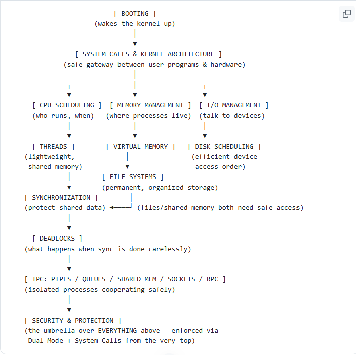

# Operating System

## The Story of an Operating System — One Connected Narrative

Think of this as **one long story** about a computer coming to life and slowly solving problems, one after another — each solution creating a *new* problem that needs the *next* system. Let's walk through it in order.

---

# Chapter 0: The Problem — "The machine is just dead hardware"

You press the power button. There's no OS yet — just silicon, RAM chips, a disk. **Problem:** how does a pile of electronics turn into something that can run programs at all?

### Solution: Booting.

Firmware (BIOS/UEFI) checks the hardware is alive (POST), finds a small bootloader on disk, which loads the **OS Kernel** into memory and hands over control. This is the "birth" of the OS — like flipping the very first light switch in a building before any employees (processes) can start working inside it.

➡️ *Now that the kernel is alive in memory, the very next problem appears immediately: user programs want to run, but they can't be trusted to touch hardware directly.*

---

# Chapter 1: The Problem — "Programs need power, but power is dangerous"

If any program could directly read/write the disk or memory of other programs, a single buggy or malicious program could crash the whole machine or steal another program's data.

### Solution: Dual Mode + System Calls + Kernel Architecture.

The kernel keeps itself in a protected **Kernel Mode**; ordinary programs run in a restricted **User Mode**. Whenever a program needs something privileged (open a file, allocate memory, talk to a device), it must go through a formal request — a **System Call** — like asking a government clerk to fetch something from a restricted archive on your behalf, rather than barging in yourself.

*How much of the OS lives inside that trusted "clerk's office"?* That's the **Kernel Architecture** question — one giant office (Monolithic, e.g. Linux) vs many small separate offices communicating by mail (Microkernel) vs a mix (Hybrid, e.g. Windows/macOS).

➡️ *Good — now a program can safely ask the kernel to do things. But the kernel just booted ONE thing. Real computers run MANY programs "at once." How?*

---

# Chapter 2: The Problem — "One CPU, many programs wanting to run"

Your computer runs a browser, a music player, and antivirus — but there's often just **one CPU core** actually available at any instant. Someone has to decide **who gets the CPU, and for how long.**

### Solution: CPU Scheduling.

The OS treats every running program as a **Process**, sitting in a queue, and a scheduler decides the order: FCFS (fair but slow), SJF (efficient but can starve long jobs), Round Robin (fair time-slicing for interactive systems), Priority + Aging, Multilevel Feedback Queues (the adaptive, real-world approach).

➡️ *Great, now multiple processes take turns on the CPU. But creating a full new Process (its own memory, its own everything) is heavy and slow — like building a whole new restaurant just to add one more waiter. Is there a lighter way to do multiple things inside ONE process?*

---

# Chapter 3: The Problem — "Processes are too heavy for lightweight concurrent tasks"

A web server wants to handle 1000 connections at once. Spinning up 1000 full processes (each with separate memory) is wasteful.

### Solution: Threads & Concurrency.

A **Thread** is a lightweight "waiter" inside the same process "restaurant," sharing memory with its sibling threads — cheap to create, cheap to switch. User-level, kernel-level, or hybrid models decide who manages these threads. Multithreading, multiprocessing, and async/event-driven models are different strategies for handling many tasks "concurrently" (structure) or truly "in parallel" (multicore execution).

➡️ *But sharing memory between threads is exactly what makes this dangerous — two threads touching the same shared variable at the same time can corrupt it. This is the exact same danger that exists between any processes sharing data (e.g., via Shared Memory IPC, covered later). We need a system to keep shared access safe.*

---

# Chapter 4: The Problem — "Shared data + multiple executors = race conditions"

Two threads (or processes) reading/writing the same variable at the same unpredictable moments can produce wrong results — a **race condition** — like two roommates both buying milk because neither knew the other already checked the fridge.

### Solution: Process Synchronization.

Locks/Mutexes, Semaphores, Monitors, and Peterson's Algorithm enforce the **Critical Section** rules (mutual exclusion, progress, bounded waiting), so only one thread/process touches shared data at a time. Classic problems (Producer-Consumer, Reader-Writer, Dining Philosophers) are the "test cases" for these tools.

➡️ *But if we're not careful with HOW we hand out locks (e.g., everyone grabs "their left fork" and waits forever for the right one), we create a brand-new, worse problem…*

---

# Chapter 5: The Problem — "Careless locking causes everyone to freeze forever"

Process A holds Resource 1 and waits for Resource 2. Process B holds Resource 2 and waits for Resource 1. **Neither ever moves again.** This is **Deadlock** — the two-cars-on-a-narrow-bridge scenario.

### Solution: Deadlock Handling.

Prevention (break one of the 4 Coffman conditions — e.g., enforce resource-request ordering), Avoidance (Banker's Algorithm — simulate before granting, like a cautious bank manager), Detection & Recovery (find cycles in a Wait-for Graph, then kill/rollback a process), or simply Ignore it (Ostrich Algorithm, since real deadlocks are rare in general-purpose systems).

➡️ *So far, everything we've solved happens INSIDE one process's shared memory. But often, separate, isolated processes (each in their own memory "house") need to legitimately talk to each other — how, if they can't just reach into each other's memory?*

---

# Chapter 6: The Problem — "Processes are isolated by design — but sometimes need to cooperate"

A parent process spawns a child to compute something and needs the result back. A browser needs to talk to a server on another continent. Isolation (a *good* thing for safety) now blocks *legitimate* cooperation.

### Solution: Inter-Process Communication (IPC).

Pipes and Named Pipes (a private or public "tube" between processes), Message Queues (a shared notice board), Shared Memory (fastest — but reintroduces the exact race-condition problem from Chapter 4, so it still needs semaphores!), Sockets (communication across different *machines*, not just within one), and RPC (make a remote call feel local).

➡️ *Notice: whether it's threads sharing memory (Ch.3) or processes using Shared Memory IPC (Ch.6), synchronization (Ch.4) is the common thread tying them together. Now, zoom out — where do all these processes and their data actually LIVE while running? We've been saying "memory" loosely — time to formalize it.*

---

# Chapter 7: The Problem — "Where do all these processes actually live, and what happens when RAM runs out?"

Every process (Ch.2), every thread (Ch.3), every shared segment (Ch.6) needs actual space in RAM. RAM is limited. Multiple processes need protected, separate spaces so they don't overwrite each other (echoing Ch.1's protection theme) — and programs often need *more* memory than physically exists.

### Solution: Memory Management.

Contiguous Allocation (simple, but fragments — First/Best/Worst Fit), **Paging** (chop into fixed frames, eliminates external fragmentation, needs a Page Table — the MMU translates Logical→Physical addresses), **Segmentation** (variable-sized, logical chunks matching program structure), and **Virtual Memory** (let programs exceed physical RAM using disk as overflow — Page Faults bring missing pages in, Page Replacement algorithms like FIFO/LRU/Optimal decide what to swap out, and too much swapping causes **Thrashing**).

➡️ *Virtual memory quietly introduced something huge: the DISK is now acting as overflow storage for memory. But the disk's real, original job is to store things PERMANENTLY, even after the process ends and the power turns off. How do we organize that permanent storage so it's actually usable?*

---

# Chapter 8: The Problem — "We need to permanently store and retrieve data, in an organized way"

RAM (Ch.7) is temporary — turn off the power, it's gone. We need durable storage, and a way to name, organize, and locate files instead of one giant unstructured blob of bytes.

### Solution: File Systems.

Directory structures (tree-based organization), File Allocation Methods (Contiguous — fast but fragments just like Ch.7's contiguous memory; Linked — no fragmentation but slow random access; **Indexed** — the disk equivalent of Paging's "map," giving fast random access), Free Space Management (bitmaps, like Ch.7's frame tracking), Journaling (crash-safe logging of planned changes), and Permissions (who can read/write — tying directly into Ch.1's protection philosophy).

➡️ *Notice the deep parallel: Indexed Allocation is to files what Paging is to memory — both solved external fragmentation using an index/map instead of forcing contiguous space. But files ultimately sit on a physical spinning/moving piece of hardware — how do we efficiently reach specific spots on that hardware?*

---

# Chapter 9: The Problem — "The disk head has to physically travel to fetch data — and that's slow"

Multiple processes (Ch.2) are requesting different files (Ch.8) stored at different physical locations on disk at the same time. If we serve these requests in a careless order, the read/write head zig-zags wastefully across the disk (like a delivery driver with a terrible route).

### Solution: Disk Scheduling.

FCFS (naive), SSTF (greedy nearest-first, but starves far requests — echoing Ch.5's starvation theme from Priority Scheduling!), SCAN/C-SCAN (elevator-style sweeps), LOOK/C-LOOK (efficient, don't overshoot to the physical edge).

➡️ *Disks are just one type of device. Zoom out further: keyboards, printers, network cards — ALL devices are slow compared to the CPU. How does the OS talk to ANY device efficiently, not just disks?*

---

# Chapter 10: The Problem — "The CPU is fast; every device is slow — don't waste CPU time waiting"

If the CPU had to sit and constantly check "is the printer done yet? is the disk done yet?" for every device, it would waste enormous amounts of time that could go to actual computation (Ch.2's scheduling would be pointless if the CPU is stuck babysitting devices).

### Solution: I/O Management.

Programmed I/O/Polling (wasteful busy-waiting), **Interrupt-driven I/O** (device signals the CPU only when done — CPU is free otherwise, tying directly back to Ch.2's scheduler being able to run OTHER processes in the meantime), **DMA** (for big transfers like disk reads from Ch.9, a controller moves data without bothering the CPU at all), Buffering (smooth out speed mismatches), and Spooling (queue competing requests for one device, like printer jobs).

➡️ *We've now covered: booting, running programs, sharing CPU, sharing memory safely, permanent storage, and talking to devices. One thread has been quietly running underneath ALL of this since Chapter 1: protection. Let's make that explicit and complete the picture.*

---

# Chapter 11: The Problem — "Now that everything is running, sharing, and connected — how do we stop it from being abused?"

Every system we've built (scheduling, memory, files, IPC, devices) assumes processes are *mostly* well-behaved. But some are buggy (protection problem) and some are actively malicious (security problem) — trying to read another process's memory (violating Ch.7), corrupt files (violating Ch.8), flood a network service (violating Ch.10's device access), or trick the kernel into doing something it shouldn't (violating Ch.1's dual-mode boundary).

### Solution: Security & Protection.

Authentication ("who are you?") + Authorization/Access Control Matrix + Principle of Least Privilege ("what are you allowed to touch?"), Encryption (protect data even if intercepted), Firewalls (filter network access — guarding the sockets from Ch.6), and reinforcing **Dual Mode Operation** from Chapter 1 as the ultimate backstop — no user program, however malicious, can bypass the kernel's gatekeeping of memory (Ch.7), disks (Ch.9), or devices (Ch.10) without going through a System Call.

---

## The Full Picture — How It All Connects



**The one-sentence version of the whole story:** *A machine boots (Ch.0) → the kernel guards hardware access via system calls (Ch.1) → it schedules the CPU among processes (Ch.2) → lightens the load with threads (Ch.3) → must synchronize their shared access (Ch.4) → carefully, or it deadlocks (Ch.5) → isolated processes cooperate via IPC (Ch.6) → everything needs memory to live in (Ch.7) → and permanent storage to persist (Ch.8) → which sits on physical disks needing efficient access (Ch.9) → alongside every other slow device (Ch.10) → and every single one of these systems must be protected from accident and attack (Ch.11) — enforced by the very same kernel boundary that woke up in Chapter 1.*

---

# CPU Scheduling — Explained Simply

**What is it?**

Imagine a **single cashier counter** in a supermarket, and many customers (processes) waiting in line. The cashier (CPU) can only serve **one customer at a time**. CPU Scheduling is the set of rules that decide **which customer (process) gets served next**, and **for how long**.

The goal: keep the cashier busy, serve customers fairly and quickly, and don't make anyone wait forever.

**Key terms (real-life analogy):**

| **Term** | **Meaning** | **Analogy** |
|----|----|----|
| Arrival Time (AT) | When process enters ready queue | When customer joins the line |
| Burst Time (BT) | Time CPU needs to finish the process | Time cashier takes to bill that customer |
| Completion Time (CT) | When process finishes | When customer leaves counter |
| Turnaround Time (TAT) | CT − AT | Total time customer spent (waiting + billing) |
| Waiting Time (WT) | TAT − BT | Time customer spent just waiting in line |
| Response Time (RT) | Time from arrival to **first** time CPU attends it | Time until cashier says "Next!" to that customer, even if not fully served yet |

---

# Scheduling Algorithms

## 1. FCFS — First Come, First Served

**Idea:** Whoever arrives first, gets served first. No cutting in line.

**Example:**

| **Process** | **AT** | **BT** |
|-------------|--------|--------|
| P1          | 0      | 5      |
| P2          | 1      | 3      |
| P3          | 2      | 8      |

Execution order: P1 → P2 → P3 (strictly by arrival)

```text
Timeline: \|--P1--\|--P2--\|-----P3-----\|

0 5 8 16
```

**Real life:** A single-lane toll booth — cars pass in the order they arrive.

**Problem:** If P1 takes very long (say 100 sec) and arrives first, everyone behind waits forever — called the **Convoy Effect** (imagine one customer buying groceries for a whole restaurant while 10 people with 1 item each wait behind).

---

## 2. SJF — Shortest Job First (Non-Preemptive)

**Idea:** Among all processes that have arrived, run the one with the **smallest burst time** next. Once started, don't interrupt it.

**Example:**

| **Process** | **AT** | **BT** |
|-------------|--------|--------|
| P1          | 0      | 7      |
| P2          | 1      | 4      |
| P3          | 2      | 1      |
| P4          | 3      | 4      |

At time 0, only P1 available → runs P1... but wait, non-preemptive means once P1 starts (only option at t=0), it runs fully even though P3 (shorter) arrives later.

**Real life:** A quick-billing counter where the cashier picks whichever customer has the **fewest items** in the cart next — but won't stop billing someone already at the counter.

**Problem:** **Starvation** — a process with a long burst time might wait forever if shorter jobs keep coming (like a person buying a fridge always losing turn to people buying candy).

---

## 3. SRTF — Shortest Remaining Time First (Preemptive SJF)

**Idea:** Same as SJF, but if a new process arrives with a shorter remaining time than the current one, **kick out the current process** and switch immediately.

**Real life:** Cashier is billing someone with 10 items remaining; a customer with just 1 item arrives — cashier says "hold on" to the first, quickly bills the 1-item customer, then resumes.

**Problem:** Also causes starvation for long processes; plus extra overhead from constant switching (**context switching**, like the cashier needing to "remember where they left off" each time).

---

## 4. Round Robin (RR)

**Idea:** Every process gets a **fixed small time slice** (called **quantum**, e.g., 2 sec). If not finished, it goes to the back of the line and waits its turn again.

**Example:** Quantum = 4

| **Process** | **BT** |
|-------------|--------|
| P1          | 5      |
| P2          | 3      |
| P3          | 8      |

```text
P1(4) P2(3) P3(4) P1(1) P3(4)

P1 runs 4 sec (1 left), P2 finishes in 3 sec, P3 runs 4 sec (4 left), P1 finishes its last 1 sec, P3 finishes remaining 4 sec.
```

**Real life:** A parent giving each kid **2 minutes** on a video game controller, then passing it to the next kid, looping around until everyone's done.

**Key tuning:**

- Quantum too **large** → behaves like FCFS.

- Quantum too **small** → too much switching overhead (like passing the controller every 2 seconds — more time lost switching hands than playing!).

---

## 5. Priority Scheduling

**Idea:** Each process has a **priority number**; highest priority runs first (can be preemptive or non-preemptive).

**Real life:** Hospital emergency room — a heart attack patient (high priority) is seen before someone with a common cold, regardless of who arrived first.

**Problem:** **Starvation** — low-priority processes may never run if high-priority ones keep arriving.

**Fix: Aging** — gradually **increase the priority** of processes that wait too long, so eventually everyone gets served (like the ER slowly upgrading the priority of the person who's been waiting 5 hours with a broken arm).

---

## 6. Multilevel Queue Scheduling

**Idea:** Processes are split into **different queues** based on type (e.g., system processes, interactive processes, batch jobs), and each queue can have its own algorithm. Queues themselves have priority.

**Real life:** An airport with separate lines: **First Class**, **Business**, **Economy** — each line has its own rules, but First Class line is checked before Economy.

**Problem:** A process is permanently in one queue — if put in "Economy" it never moves to Business, even if it behaves well.

---

## 7. Multilevel Feedback Queue

**Idea:** Like above, but processes **can move between queues** based on behavior — e.g., if a process uses too much CPU time, demote it to a lower-priority queue.

**Real life:** Airport line where if you're taking too long at check-in (using more time than expected), you get moved to a slower line; but if you're quick, you might get promoted to a faster line.

**Benefit:** Most flexible, adapts to actual process behavior. Used in real OS (Linux, Windows) in modified forms.

---

**Comparison Cheat Sheet**

| **Algorithm** | **Preemptive?** | **Starvation Risk** | **Best For** |
|----|----|----|----|
| FCFS | No | Convoy effect | Simple batch systems |
| SJF | No | Yes | Minimizing avg wait time (needs future knowledge) |
| SRTF | Yes | Yes | Minimizing wait, but high overhead |
| Round Robin | Yes | No | Time-sharing/interactive systems |
| Priority | Either | Yes (fixed with aging) | Real-time/critical tasks |
| Multilevel Queue | Either | Yes | Distinct process categories |
| Multilevel Feedback | Yes | No (adaptive) | General-purpose modern OS |

---

**Practice Problems / Exercises**

1.  **FCFS Calculation:** Given AT/BT table, compute CT, TAT, WT for each process, and average WT & TAT.

```text
P1: AT=0, BT=4

P2: AT=1, BT=3

P3: AT=2, BT=1

P4: AT=3, BT=5

2.  **SJF (Non-preemptive):** Using the same table above, schedule using SJF and compare avg waiting time to FCFS.

3.  **SRTF (Preemptive SJF):** Same processes — draw the Gantt chart assuming preemption is allowed. Compute avg TAT/WT.

4.  **Round Robin:** With quantum = 2, schedule:
```

```text
P1: BT=5

P2: BT=4

P3: BT=2

Draw the Gantt chart and compute average waiting time. Then repeat with quantum = 4 — observe how results change.

5.  **Priority Scheduling with Starvation:** Given 5 processes with different priorities where a low-priority process never runs — implement **aging** (increase priority by 1 every 5 sec of waiting) and show it eventually executes.

6.  **Convoy Effect Scenario:** Create a scenario with 1 long process (BT=100) arriving first and 5 short ones (BT=1 each) arriving right after. Compute average waiting time under FCFS vs SJF — observe the difference.

7.  **Conceptual:** Why is Round Robin considered fair for **time-sharing systems** but not efficient for **batch systems**?

8.  **Real-world mapping:** Identify which scheduling algorithm best models:

    - A hospital ER

    - A single ATM machine line

    - A customer support call center with VIP customers

    - A modern multitasking OS running background + foreground apps
```

---

**Process Synchronization — Explained Simply**

**What is it?**

Imagine **two people sharing one bank account**. Both try to withdraw money **at the same time** from two different ATMs. If the system isn't careful, both might read the balance as ₹1000, both withdraw ₹800, and the bank ends up giving out ₹1600 from an account that only had ₹1000!

**Process Synchronization** is about making sure that when multiple processes/threads **share the same data or resource**, they don't step on each other's toes and corrupt things.

---

**Key Problem: The Race Condition**

**Race Condition** = when the final result depends on the **timing/order** of execution of multiple processes, and that timing is unpredictable.

**Real-life example:** Two roommates both check the fridge, see "no milk," and both go out and buy milk — because neither knew the other was also checking at the same time. Result: wasted duplicate milk (or in computers: wasted/corrupted data).

**Code example (bank balance bug):**

```text
balance = 1000

Process A: Process B:

read balance (1000) read balance (1000)

balance = balance - 800 balance = balance - 800

write balance (200) write balance (200)

Both withdrew ₹800, but the balance only reduced by ₹800 total instead of ₹1600 — **money got created out of nowhere** due to bad timing. This is the classic race condition.
```

---

**Critical Section Problem**

The **Critical Section** is the part of code where a process accesses **shared resource** (like the balance variable). We need rules so **only one process is inside the critical section at a time**.

**Real-life analogy:** A single-person restroom with a lock. Only one person (process) can be inside (critical section) at a time; others wait outside.

**Three conditions any solution must satisfy:**

| **Condition** | **Meaning** | **Analogy** |
|----|----|----|
| **Mutual Exclusion** | Only 1 process in critical section at a time | Only 1 person in the restroom |
| **Progress** | If restroom is free, someone waiting should be able to enter (no unnecessary blocking) | Restroom isn't kept locked for no reason |
| **Bounded Waiting** | A process shouldn't wait forever (no starvation) | You won't be stuck outside forever while others keep cutting in |

---

**Solutions / Algorithms**

## 1. Locks / Mutex (Mutual Exclusion)

**Idea:** A **lock** is like a **key to the restroom**. Before entering the critical section, a process must "acquire" the lock; after finishing, it "releases" it.

```text
lock.acquire()

// critical section (e.g., balance = balance - 800)

lock.release()
```

**Real life:** A single restroom key hanging outside. You take the key, go in, lock the door, come out, hang the key back. Next person only enters if they have the key.

**Limitation:** If a process forgets to release the lock (crashes inside), everyone else is stuck forever — like someone taking the restroom key and never coming back.

---

## 2. Semaphores

**Idea:** A **semaphore** is a counter that controls access to a resource with a limited number of "slots."

- **Binary Semaphore** (0 or 1) — works like a mutex (one at a time).

- **Counting Semaphore** (any number) — allows a fixed number of processes at once.

**Operations:**

- wait() (also called P) — decreases counter; if counter \< 0, process waits.

- signal() (also called V) — increases counter; wakes up a waiting process.

**Real life:** A parking lot with **5 spots** (counting semaphore = 5). A digital sign shows spots left. Car enters → sign decreases by 1 (wait). Car leaves → sign increases by 1 (signal). If sign shows 0, new cars must wait outside.

```text
semaphore parking_spots = 5

Car arrives:

wait(parking_spots) // spots--

... parks ...

Car leaves:

signal(parking_spots) // spots++
```

---

## 3. Monitors

**Idea:** A **monitor** is a higher-level, easier-to-use construct — like a "smart room" that **automatically** ensures only one process can execute its methods at a time, without the programmer manually managing locks.

**Real life:** Think of a **bank locker room managed by staff**: you don't handle the master key yourself — you just tell the staff "I want locker 5," and the *staff* (monitor) ensures no two people access locker 5 at the same time. You don't worry about lock/unlock logic; it's handled for you.

**Benefit:** Reduces programmer errors (forgetting to unlock, deadlocks from misuse) compared to raw semaphores.

---

## 4. Peterson's Algorithm (Software-based, 2 processes)

**Idea:** A classic algorithm for **2 processes** to achieve mutual exclusion using just 2 variables — no special hardware needed.

Variables:

- flag\[i\] = true if process i **wants** to enter critical section.

- turn = whose turn it is if both want to enter.

**Real life:** Two friends both want the last slice of pizza. Rule: "Whoever raises hand first (flag=true) AND it's not specifically the other's turn, goes first." If both raise hands, they check a coin-flip agreement (turn) to decide who goes.

```text
Process 0: Process 1:

flag\[0\] = true flag\[1\] = true

turn = 1 turn = 0

while (flag\[1\] && turn==1); while (flag\[0\] && turn==0);

// critical section // critical section

flag\[0\] = false flag\[1\] = false
```

**Limitation:** Only works for **2 processes**; doesn't scale well, and modern CPUs with instruction reordering can break it without special handling.

---

**Classic Synchronization Problems (used to test algorithms)**

**A. Producer-Consumer Problem (Bounded Buffer)**

**Setup:** A **producer** creates items and puts them in a fixed-size buffer; a **consumer** takes items out. They share the buffer.

**Real life:** A baker (producer) puts bread on a shelf (buffer) with room for 10 loaves. A customer (consumer) takes bread off the shelf. If the shelf is full, baker waits. If the shelf is empty, customer waits.

**Uses:** 2 semaphores (empty = free slots, full = filled slots) + 1 mutex for the buffer itself.

---

**B. Reader-Writer Problem**

**Setup:** Multiple **readers** can read shared data simultaneously (no harm), but a **writer** needs **exclusive access** (no one else reading or writing).

**Real life:** A shared Google Doc — many people can **view** (read) at once, but if someone needs to do a **major edit** that requires locking the doc (write), everyone else must pause until it's done.

**Variants:** Reader-priority (readers don't wait for writers unless one is already writing) vs Writer-priority (writers get priority to avoid starving them).

---

**C. Dining Philosophers Problem**

**Setup:** 5 philosophers sit at a round table, 5 forks between them (1 fork between each pair). Each philosopher needs **both** the fork on their left and right to eat. They alternate between thinking and eating.

**Real life:** Imagine 5 people at a table with only 5 chopsticks between them (one shared per pair) — everyone needs 2 chopsticks to eat, but only 5 exist for 5 people, so there's contention.

**Problem it illustrates:** **Deadlock** — if everyone picks up their **left fork at the same time**, everyone waits forever for the right fork (which their neighbor is holding). Nobody can eat = system frozen.

**Solutions:**

- Allow only 4 philosophers to sit at once (break the symmetry).

- Odd philosophers pick left fork first, even ones pick right fork first (breaks the circular wait).

- Use a waiter (central authority) who grants permission to pick up forks.

---

**Quick Comparison**

| **Mechanism** | **Complexity** | **Use Case** |
|----|----|----|
| Lock/Mutex | Simple | Single shared resource, 1 at a time |
| Semaphore | Medium | Limited-count resources (e.g., parking spots) |
| Monitor | High-level (built-in safety) | Cleaner code, avoids manual lock mismanagement |
| Peterson's Algorithm | Low-level, educational | Understanding mutual exclusion from scratch (2 processes) |

---

**Practice Problems / Exercises**

1.  **Race Condition Simulation:** Write pseudocode for two threads incrementing a shared variable counter 100,000 times each without synchronization. Explain why the final value is often less than 200,000.

2.  **Fix with Mutex:** Rewrite the above using a lock/mutex around the increment operation. Explain why this guarantees the correct final value.

3.  **Semaphore Design:** Design a semaphore-based solution for a **movie theater with 50 seats** — moviegoers (processes) should be blocked from entering once all seats are full, and let in as seats become available.

4.  **Producer-Consumer:** Implement pseudocode for producer-consumer using a buffer of size 5. Show what happens (and how it's prevented) if producer tries to add to a full buffer.

5.  **Reader-Writer:** Design semaphore logic where multiple readers can read simultaneously, but a writer gets exclusive access. Discuss: what happens if writers are given priority — could readers starve?

6.  **Dining Philosophers Deadlock Demo:** Show the exact sequence of fork-pickups by 5 philosophers that leads to deadlock. Then apply the "odd-even" fix and show deadlock is avoided.

7.  **Peterson's Algorithm Trace:** Given 2 processes using Peterson's algorithm, trace through variables flag\[0\], flag\[1\], and turn step by step to show mutual exclusion is guaranteed.

8.  **Conceptual:** Explain the difference between a **deadlock** and a **race condition** with one real-life example each.

9.  **Starvation vs Deadlock:** In the Dining Philosophers problem, describe a fix that avoids deadlock but could still cause **starvation** for one philosopher. How would you fix that too (hint: aging / fairness ordering)?

---

**Deadlocks — Explained Simply**

**What is it?**

**Deadlock** = a situation where two or more processes are **stuck forever**, each waiting for a resource that another stuck process is holding. Nobody can move forward.

**Real-life example:** Two cars meet on a **single-lane bridge** from opposite directions. Car A won't reverse because it expects Car B to reverse, and Car B won't reverse because it expects Car A to. Both just sit there honking — forever. That's a deadlock.

Another classic: Two people at a narrow doorway, each politely stepping aside for the other — except in deadlock's evil twin, imagine they instead **each refuse to move and demand the other move first**. Total gridlock.

---

**The 4 Necessary Conditions (Coffman Conditions)**

For a deadlock to happen, **ALL 4** of these must be true simultaneously:

| **Condition** | **Meaning** | **Analogy** |
|----|----|----|
| **Mutual Exclusion** | Resource can be used by only one process at a time | Only one car fits on the narrow bridge at once |
| **Hold and Wait** | A process holds a resource while waiting for another | Car A is sitting on the bridge (holding it) while waiting for the road ahead (held by car B) to clear |
| **No Preemption** | A resource can't be forcibly taken away; it must be released voluntarily | You can't tow Car A off the bridge — it must reverse itself |
| **Circular Wait** | A cycle exists: P1 waits for P2, P2 waits for P3, ... waits for P1 | Car A waits for Car B, and Car B waits for Car A — a closed loop |

**Break any ONE of these 4 conditions → no deadlock is possible.** This is the foundation of every deadlock-handling strategy below.

---

**Resource Allocation Graph (RAG)**

A simple diagram to **visualize** who's waiting for what:

- **Process → Resource** arrow = process is **requesting** that resource.

- **Resource → Process** arrow = resource is **currently allocated** to that process.

**Real life:** Think of it like a chart showing "Ravi wants the stapler that Priya has, and Priya wants the pen that Ravi has."

```text
P1 → R1 (P1 requests R1)

R1 → P2 (R1 is held by P2)

P2 → R2 (P2 requests R2)

R2 → P1 (R2 is held by P1)

If you can trace a **cycle** in this graph (P1 → R1 → P2 → R2 → P1), there's a **potential deadlock** (guaranteed deadlock if each resource has only 1 instance).
```

---

**Strategies to Handle Deadlocks**

## 1. Deadlock Prevention (Attack one of the 4 conditions)

**Idea:** Design the system so at least one Coffman condition can **never** occur.

| **Break This** | **How** | **Real-life Analogy** |
|----|----|----|
| Mutual Exclusion | Make resources shareable (not always possible, e.g., a printer can't be shared mid-print) | Turn the "1-person restroom" into a spacious shared lounge |
| Hold and Wait | Force process to request **all** resources at once, upfront | Before crossing the bridge, car must confirm the entire road ahead is clear, not just the bridge |
| No Preemption | Allow forcibly taking resources away | Tow truck removes Car A from the bridge if it's stuck too long |
| Circular Wait | Impose an **ordering** on resources; must request in increasing order | Rule: "Always request stapler before pen, never pen before stapler" — breaks the circular pattern |

**Real life for Circular Wait fix:** If everyone at a dinner table is told "always pick up the fork on your LEFT before your right, except the last person who must pick up right first" — it breaks the perfect symmetry that causes deadlock (this is literally the Dining Philosophers fix).

---

## 2. Deadlock Avoidance — Banker's Algorithm

**Idea:** Instead of preventing deadlock outright, the system **checks in advance** whether granting a resource request could lead to a deadlock. If yes, it makes the process **wait**, even if the resource is currently free.

**Real-life analogy:** A **bank manager** won't approve a loan if giving it out would leave the bank without enough cash to satisfy other loan commitments already promised — even though technically the cash is "available" right now. The bank keeps enough buffer to always be able to satisfy **at least one** customer fully, and once that customer repays, the bank can help the next one, and so on — like a **safe sequence**.

**Key idea: "Safe State"** A state is **safe** if there's *some order* in which all processes can finish, even if they all ask for their maximum resources.

**Simple Example:**

Total resources: 12 units of "R"

| **Process** | **Max Need** | **Currently Holding** | **Still Needs** |
|-------------|--------------|-----------------------|-----------------|
| P1          | 10           | 5                     | 5               |
| P2          | 4            | 2                     | 2               |
| P3          | 9            | 2                     | 7               |

Available = 12 − (5+2+2) = 3

- Can P2 finish with 3 available? Needs 2, we have 3 → **Yes**. P2 finishes, releases its 2 → Available = 5

- Can P1 finish with 5 available? Needs 5 → **Yes**. P1 finishes, releases 5 → Available = 10

- Can P3 finish with 10 available? Needs 7 → **Yes**.

**Safe sequence found: P2 → P1 → P3** ✅ System is in a safe state, so any new request is checked against this logic before being granted.

**Real life summary:** Before approving any new loan/resource, the bank manager mentally simulates: "If I give this out, can I still guarantee everyone eventually gets paid in some order?" If yes → approve. If no → make them wait.

---

## 3. Deadlock Detection & Recovery

**Idea:** Don't bother preventing or avoiding — let deadlocks happen, but periodically **check** for them (using the Resource Allocation Graph / Wait-for Graph for cycles), and **recover** when found.

**Real life:** Like a traffic helicopter periodically checking intersections for total gridlock, and when found, sending a tow truck to physically remove a car.

**Detection:** Build a **Wait-for Graph** — simplified version of RAG showing only Process → Process edges (who's waiting for whom). If there's a **cycle**, deadlock exists.

**Recovery options:**

| **Method** | **Real-life Analogy** |
|----|----|
| **Kill one process** (abort victim) | Tow one car off the bridge entirely (it must restart its trip) |
| **Kill all deadlocked processes** | Clear the whole gridlock by removing every car involved (drastic) |
| **Preempt resources** (roll back a process to a safe checkpoint) | Ask a car to reverse to its last "checkpoint" position, freeing the road temporarily |

---

## 4. Deadlock Ignorance (Ostrich Algorithm)

**Idea:** Just **pretend deadlocks don't happen** — because they're rare, and prevention/avoidance costs are too high for everyday use.

**Real life:** Most real bridges, elevators, and everyday systems don't build in complex deadlock-avoidance logic — because gridlocks are rare enough that it's cheaper to just deal with them if they ever occur (e.g., manually, or a system reboot), rather than slow everything down every single day just in case.

**Fun fact:** This is literally what **most real operating systems** (like Windows, Linux) do for general-purpose deadlocks — it's called the **Ostrich Algorithm** ("bury head in the sand").

---

**Quick Comparison**

| **Strategy** | **When Used** | **Cost** | **Real-life feel** |
|----|----|----|----|
| Prevention | Critical systems (avoid deadlock at all costs) | High (restrictive, less resource utilization) | Strict traffic rules everywhere |
| Avoidance (Banker's) | Systems where max resource needs are known upfront | Medium (needs prior knowledge, computation overhead) | Bank manager pre-checking every loan |
| Detection & Recovery | Systems where deadlocks are rare but must be fixed when they happen | Medium (periodic checks + recovery cost) | Traffic helicopter + tow truck |
| Ignorance (Ostrich) | Most general-purpose OS | Low (do nothing) | Just wait for a human to notice and reboot |

---

**Practice Problems / Exercises**

1.  **Identify Coffman Conditions:** In the bridge example (2 cars, opposite directions), identify all 4 Coffman conditions explicitly.

2.  **Resource Allocation Graph:** Draw a RAG for this scenario and state whether deadlock exists:

    - P1 holds R1, requests R2

    - P2 holds R2, requests R1

3.  **Banker's Algorithm Calculation:** Given:

```text
Total Resources: A=10, B=5, C=7

Process \| Allocation (A,B,C) \| Max (A,B,C)

P0 \| 0,1,0 \| 7,5,3

P1 \| 2,0,0 \| 3,2,2

P2 \| 3,0,2 \| 9,0,2

P3 \| 2,1,1 \| 2,2,2

P4 \| 0,0,2 \| 4,3,3
```

Find the **Available** vector, and determine if the system is in a **safe state**. If yes, find a safe sequence.

4.  **Request Check:** Using the above data, if P1 requests (1,0,2) additional resources, use the Banker's algorithm to decide whether this request should be **granted immediately** or made to **wait**.

5.  **Wait-for Graph Detection:** Convert a given Resource Allocation Graph (with multiple instances of resources) into a Wait-for Graph and identify any cycles indicating deadlock.

6.  **Prevention Design:** Propose a real-world rule (like the "always request in increasing order" idea) to prevent deadlock in a scenario with 3 shared resources: Printer, Scanner, and Fax machine used by multiple office employees.

7.  **Conceptual — Prevention vs Avoidance:** Explain in your own words why Deadlock Avoidance (Banker's Algorithm) needs to know the **maximum resource requirement in advance**, while Prevention does not.

8.  **Recovery Trade-off:** If a detection algorithm finds 3 processes deadlocked, discuss the pros/cons of (a) killing all 3 vs (b) killing just 1 and re-checking.

9.  **Real-world Mapping:** For each of the following, identify whether Prevention, Avoidance, Detection, or Ignorance is the most practical approach, and why:

    - A NASA spacecraft's life-support control system

    - Your personal laptop's OS

    - A busy hospital's resource-booking system (operating theatres, equipment)

    - A single-lane bridge with traffic lights installed on both ends

---

**Threads & Concurrency — Explained Simply**

**What is it?**

A **Process** is like an entire **restaurant** (has its own kitchen, staff, inventory — its own memory space). A **Thread** is like a **waiter** working inside that restaurant. A restaurant can have **multiple waiters (threads)** working together, sharing the same kitchen and inventory (memory), instead of building a whole new restaurant for every waiter.

**Concurrency** is about handling **multiple tasks that appear to happen at the same time** — even on a single-core CPU (like one chef quickly switching between multiple dishes, giving the illusion of cooking them simultaneously).

**Parallelism** is about tasks *actually* running **at the exact same time** — like 4 chefs on 4 different stoves in a multi-core kitchen, each cooking a separate dish simultaneously.

**Concurrency = dealing with lots of things at once (structure)** **Parallelism = doing lots of things at once (execution)**

---

**Process vs Thread**

| **Feature** | **Process** | **Thread** |
|----|----|----|
| Memory | Own separate memory space | Shares memory with other threads in same process |
| Creation cost | Heavy (slow to create) | Lightweight (fast to create) |
| Communication | Needs IPC (pipes, sockets — slow) | Direct (shared variables — fast, but risky) |
| Crash impact | One process crashing doesn't affect others | One thread crashing can crash the whole process |
| Real-life analogy | Separate restaurants, each with own kitchen | Waiters in the same restaurant sharing one kitchen |

**Why use threads instead of processes?** Because sharing the "kitchen" (memory) means waiters (threads) can quickly pass information to each other without expensive coordination — much faster than restaurants (processes) calling each other on the phone (IPC).

---

**Thread Models**

## 1. User-Level Threads

**Idea:** Threads are managed entirely by a **library in user space**; the OS kernel doesn't even know they exist — it just sees **one process**.

**Real life:** A restaurant manager (user-level thread library) assigns tasks to waiters internally, but from outside, the government (OS kernel) only sees "one restaurant business license" — it has no idea how many waiters are inside.

**Pros:** Fast to create/switch (no need to bother the OS). **Cons:** If one waiter (thread) gets stuck waiting for something (like a blocking I/O call), the **whole restaurant stops** — because the OS doesn't know there are other waiters who could keep working.

## 2. Kernel-Level Threads

**Idea:** The OS **kernel itself** knows about and manages each thread individually.

**Real life:** Now the government (OS) has a registry of every individual waiter by name. If one waiter (thread) is stuck helping a slow customer, the government can say "fine, let another waiter continue serving other tables" — the whole restaurant doesn't grind to a halt.

**Pros:** More robust — one blocked thread doesn't block all others. **Cons:** Slower to create/manage (must go through the OS every time — more overhead, like needing government paperwork for every new waiter hired).

---

## 3. Hybrid (Many-to-Many) Model

**Idea:** Combine both — many user-level threads are mapped onto a smaller or equal number of kernel threads, get the best of both worlds.

**Real life:** The restaurant manager assigns 10 internal waiter roles, but only registers 4 with the government — flexible enough to shuffle internally while still getting OS-level support if something blocks.

---

**Multithreading Benefits (Real-life)**

| **Benefit** | **Analogy** |
|----|----|
| **Responsiveness** | While one waiter is taking a slow order, another can still serve drinks — customers aren't left standing |
| **Resource Sharing** | All waiters share the same kitchen inventory — no duplicate stock needed |
| **Economy** | Hiring a new waiter (thread) is cheaper/faster than opening a new restaurant (process) |
| **Scalability** | On a multi-core kitchen (multi-core CPU), waiters can truly work in parallel on different stoves |

---

**Concurrency Problems (Recap Link)**

Since threads **share memory**, they run into the exact same problems from Process Synchronization: **race conditions**, and need **locks/semaphores/monitors** to coordinate — e.g., two waiters (threads) both grabbing the last steak from the shared fridge (shared variable) at the same time.

**Concurrency Models / Approaches**

## 1. Multiprocessing (multiple processes)

**Idea:** Use separate processes instead of threads for parallel work — each with its own memory, safer but heavier.

**Real life:** Instead of waiters sharing one kitchen, you open **several small independent restaurant branches**. Safer (one branch burning down doesn't affect others) but costlier to set up each one.

---

## 2. Multithreading (multiple threads in one process)

**Idea:** As explained above — waiters sharing one kitchen.

---

## 3. Asynchronous / Event-Driven (Single-threaded, Non-blocking)

**Idea:** Instead of using multiple waiters, have **ONE super-efficient waiter** who never stands and waits. When they give an order to the kitchen, they immediately move to the next customer instead of standing at the kitchen window waiting for food to be ready. When food IS ready, a bell rings (callback/event) and the waiter delivers it.

**Real life:** A single waiter juggling all tables, taking orders, and instantly moving to the next table rather than blocking on any one — this is how **Node.js** and other event-loop-based systems work.

```text
waiter.takeOrder(table1) → kitchen starts cooking (non-blocking)

waiter.takeOrder(table2) → kitchen starts cooking (non-blocking)

... (bell rings: table1's food ready) → waiter.deliver(table1)

... (bell rings: table2's food ready) → waiter.deliver(table2)
```

**Pros:** No thread-switching overhead, no race conditions on shared memory (since it's single-threaded). **Cons:** If any one step **blocks** (e.g., waiter gets stuck on a very slow, non-interruptible task), the entire restaurant stalls — because there's only ONE waiter.

---

**Multicore Programming Challenges**

**Real life:** Splitting one recipe among 4 chefs sounds efficient, but:

- **Dividing the task** — some steps depend on others (you can't fry an egg before cracking it) → this is called **task dependency**.

- **Balance** — if one chef gets all the easy tasks and another gets all hard ones, some finish early and sit idle (**load balancing** problem).

- **Data splitting** — dividing shared ingredients (data) among chefs without conflicts.

- **Testing/debugging difficulty** — bugs that only show up with a specific unlucky timing (**race conditions**) are notoriously hard to reproduce and fix.

---

**Quick Comparison**

| **Model** | **Memory** | **Best For** | **Real-life** |
|----|----|----|----|
| Multiprocessing | Isolated | Safety/fault-isolation critical apps | Separate restaurant branches |
| Multithreading | Shared | Fast, tightly coordinated tasks | Waiters sharing one kitchen |
| Async/Event-driven | Single-threaded, shared | I/O-heavy apps (web servers) | One efficient non-blocking waiter |

---

**Practice Problems / Exercises**

1.  **Process vs Thread Design:** You're building a web browser. Explain why each open tab is typically implemented as a **separate process** (hint: think about what happens if one tab crashes).

2.  **User vs Kernel Threads:** Give a real-world scenario where a **user-level thread** model would fail badly (hint: one thread doing a blocking file read).

3.  **Race Condition Recap:** Two threads in the same process both increment a shared total_orders counter without synchronization. Show how the final count could be wrong, and fix it using a mutex (link back to Process Synchronization topic).

4.  **Async vs Threaded Design:** You're designing a chat server that needs to handle 10,000 simultaneous connections. Compare handling this with (a) one thread per connection vs (b) a single-threaded event loop. Which uses less memory? Which is harder to program correctly?

5.  **Multicore Task Division:** Given a task "sum an array of 1,000,000 numbers," design a way to split it across 4 threads (multicore), and explain how you'd combine the partial results safely (hint: avoid a shared variable race condition when combining).

6.  **Conceptual — Concurrency vs Parallelism:** Explain with a real-life example (not from this text) the difference between concurrency and parallelism.

7.  **Amdahl's Law (bonus calculation):** If 70% of a program can be parallelized and 30% must remain sequential, calculate the theoretical maximum speedup achievable with infinite cores. *(Formula: Speedup = 1 / (S + (1-S)/N), where S = sequential portion, N = number of cores → as N→∞)*

8.  **Thread Pool Design:** Explain why creating a **new thread for every single incoming request** on a busy web server is inefficient, and how a **thread pool** (fixed number of reusable threads) solves this. Relate this back to "Economy" benefit of threads mentioned above.

---

**Memory Management — Explained Simply**

**What is it?**

Imagine your computer's RAM (memory) as a **large apartment building**, and processes (programs) as **tenants** who need a place to live (space to store their data/instructions) while running. Memory Management is the **building manager's job**: deciding who gets which apartment, how big, how to handle when the building is full, and how to keep tenants from wandering into each other's apartments.

---

**Key Concepts**

## 1. Logical vs Physical Address

- **Logical Address** = the address a program *thinks* it's using (like an apartment number a tenant remembers, e.g., "Apt 5").

- **Physical Address** = the *actual* location in RAM hardware (like the real GPS coordinates of the building).

**Real life:** You tell a delivery driver "Apt 5" (logical), but the building directory translates that into the *actual floor and unit location* (physical) — this translation is done by the **MMU (Memory Management Unit)**.

---

## 2. Contiguous Memory Allocation

**Idea:** Give each process **one continuous block** of memory.

**Real life:** Like giving each tenant one continuous stretch of rooms — Tenant A gets rooms 1-5, Tenant B gets rooms 6-8, etc.

**Problem — Fragmentation:**

- **External Fragmentation:** Free memory exists, but it's scattered in small non-contiguous chunks, none big enough for a new process. **Real life:** Building has 3 empty rooms, but they're scattered (room 2, room 15, room 40) — a tenant needing 3 *adjacent* rooms can't move in, even though 3 rooms are technically free.

- **Internal Fragmentation:** A process is given more memory than it needs, wasting the leftover inside its own allocated block. **Real life:** Tenant needs 2.5 rooms worth of space, but building only rents in whole-room units, so they get 3 rooms — half a room's space goes to waste, forever unused by anyone else.

**Allocation Strategies:**

| **Strategy** | **Idea** | **Analogy** |
|----|----|----|
| **First Fit** | Allocate the *first* free block big enough | Move tenant into the first vacant block you find while walking down the hallway |
| **Best Fit** | Allocate the *smallest* free block that's big enough (least waste) | Search the whole building, pick the block that fits tightest (least leftover space) |
| **Worst Fit** | Allocate the *largest* free block available | Give tenant the biggest available block, leaving a big leftover chunk for future big tenants |

---

## 3. Paging

**Idea:** Instead of giving contiguous space, chop **memory into fixed-size blocks called frames**, and chop the **process into equal-sized pieces called pages**. Any page can go into any free frame — no need for contiguous space!

**Real life:** Instead of forcing a family to live in *adjacent* rooms, you give them **individual lockers scattered anywhere** in a huge locker facility, and keep a **map (page table)** that says "Locker 5 = Family's Photo Album, Locker 42 = Family's Clothes," etc. The family doesn't need adjacent lockers — the building manager's map tracks where everything is.

**Diagram:**

```text
Process (Logical View) Physical Memory (Frames)

+--------+ +----------+

\| Page 0 \| ---------------\> \| Frame 3 \|

+--------+ +----------+

\| Page 1 \| ---------------\> \| Frame 7 \|

+--------+ +----------+

\| Page 2 \| ---------------\> \| Frame 1 \|

+--------+ +----------+
```

**Page Table:** The "map" that translates Page → Frame.

**Benefit:** Eliminates **external fragmentation** entirely (any free frame works for any page). Still has minor **internal fragmentation** (last page of a process might not fully fill its frame — like the last locker only half-used).

**Address translation:**

```text
Logical Address = Page Number + Offset

Physical Address = (Frame Number from Page Table) + Offset
```

---

## 4. Segmentation

**Idea:** Instead of fixed-size chunks (pages), divide the program into **logical, variable-sized parts** — like "Code segment," "Data segment," "Stack segment" — matching how the programmer actually thinks about the program.

**Real life:** Instead of scattering identical-sized lockers, you give the family **named sections**: one *whole room* for "Kitchen stuff," another *whole room* for "Bedroom stuff" — sizes vary based on actual need, and each has a clear label.

**Diagram:**

```text
Segment Table:

Segment 0 (Code) → Base: 1000, Limit: 400

Segment 1 (Data) → Base: 2000, Limit: 150

Segment 2 (Stack) → Base: 3000, Limit: 100
```

**Benefit:** Matches logical program structure (easier protection — e.g., mark "Code" as read-only). **Downside:** Since segments are variable-sized, it **brings back external fragmentation** (like the contiguous allocation problem).

**Paging vs Segmentation:**

| **Feature** | **Paging** | **Segmentation** |
|----|----|----|
| Block size | Fixed | Variable |
| Fragmentation | Internal only | External |
| Matches program logic? | No (arbitrary chunks) | Yes (code/data/stack) |
| Real life | Identical lockers, scattered | Labeled rooms, different sizes |

*(Many real systems combine both — "Segmented Paging" — like labeled rooms that are each internally split into same-sized lockers.)*

---

## 5. Virtual Memory

**Idea:** Let programs use **more memory than physically exists**, by keeping only the actively-used parts in RAM and storing the rest on disk, swapping pages in/out as needed.

**Real life:** Think of RAM as your **desk** (small, fast to work on) and your hard disk as a **warehouse** (huge, but slow to fetch things from). You don't keep every document you own on your desk — only what you're actively using. When you need a document from the warehouse, you fetch it and maybe put something else back to make room.

**Key Term — Page Fault:** When a program accesses a page that's **not currently in RAM** (it's in the warehouse/disk), the OS must fetch it — this pause is called a **page fault**.

```text
Process accesses Page 5

↓

Is Page 5 in RAM?

No → PAGE FAULT → OS fetches Page 5 from disk into a free frame

Yes → proceed normally
```

**Real life:** You reach for a document in your desk drawer, but it's not there (it's in the warehouse) — you must send someone to fetch it (page fault), which takes time, before you can continue working.

---

## 6. Page Replacement Algorithms

When RAM (desk) is full and a new page needs to come in, **something must be swapped out**. Which page to remove?

**a) FIFO (First-In-First-Out)**

**Idea:** Remove the **oldest** page loaded into memory, regardless of how often it's used.

**Real life:** Your desk has room for 3 documents. Whichever document you brought to your desk **first** gets sent back to the warehouse first when a new one arrives — even if you still need it.

**Problem — Belady's Anomaly:** Sometimes *adding more desk space (frames)* can *increase* the number of page faults with FIFO — counter-intuitive!

**b) LRU (Least Recently Used)**

**Idea:** Remove the page that **hasn't been touched for the longest time** — assume "if you haven't used it recently, you probably won't need it soon."

**Real life:** Of the 3 documents on your desk, send back the one you **haven't looked at in the longest time** — keeping the ones you're actively referencing.

**Example:** Reference string: 1, 2, 3, 1, 4 with 3 frames

```text
1 → \[1\] fault

2 → \[1,2\] fault

3 → \[1,2,3\] fault

1 → \[1,2,3\] hit (1 already there)

4 → \[2,3,4\] fault, remove 1 (least recently used)
```

**c) Optimal Page Replacement (OPT)**

**Idea:** Remove the page that **won't be used for the longest time in the future**.

**Real life:** Like having a psychic desk assistant who knows exactly which document you won't need again for the longest time, and clears that one first.

**Catch:** Requires knowing the **future** — impossible in real systems, but used as a **theoretical best-case benchmark** to compare other algorithms against.

---

## 7. Thrashing

**Idea:** When the system spends **more time swapping pages in/out than actually doing useful work** — because too many processes are competing for too little RAM.

**Real life:** Imagine your desk is so small, and you have so many active documents, that you spend ALL your time running back and forth to the warehouse, and barely get any actual work done. Your "productivity" collapses even though you're technically "busy."

**Fix:** Reduce the number of active processes (reduce **degree of multiprogramming**), or add more RAM.

```text
Degree of Multiprogramming → (too high) → Thrashing → CPU Utilization crashes
```

---

**Quick Comparison**

| **Concept** | **Fixes** | **Real-life** |
|----|----|----|
| Paging | External fragmentation | Scattered identical lockers + map |
| Segmentation | Matches logical structure | Labeled variable-size rooms |
| Virtual Memory | Lets programs exceed physical RAM | Desk + warehouse system |
| FIFO | Simple but can be suboptimal | Oldest document goes back first |
| LRU | Smarter, based on recent usage | Least recently touched document goes back |
| Optimal | Best possible (theoretical) | Psychic assistant, future-aware |

---

**Practice Problems / Exercises**

1.  **Fragmentation Identification:** Given a memory layout with free blocks of size 100KB, 500KB, 200KB, 300KB, 600KB, allocate processes needing 212KB, 417KB, 112KB, and 426KB using **First Fit**, **Best Fit**, and **Worst Fit**. Compare leftover fragmentation in each.

2.  **Paging Address Translation:** Given a page size of 1KB, and logical address 3350, calculate the **page number** and **offset**. If Page Table says Page 3 → Frame 8, what's the physical address?

3.  **Page Replacement — FIFO vs LRU:** Given reference string: 7, 0, 1, 2, 0, 3, 0, 4, 2, 3, 0, 3, 2 with 3 frames, calculate the number of page faults using FIFO and LRU. Compare results.

4.  **Belady's Anomaly Demo:** Using reference string 1, 2, 3, 4, 1, 2, 5, 1, 2, 3, 4, 5, calculate page faults with FIFO using 3 frames, then repeat with 4 frames. Show that more frames caused MORE faults (or research and confirm with the standard textbook example).

5.  **Optimal Algorithm Practice:** Using the same reference string as in Q3, calculate the number of page faults using the **Optimal** algorithm, and compare it to FIFO/LRU — confirm it has the fewest faults.

6.  **Thrashing Scenario:** A system has 4GB RAM, running 50 processes each needing 200MB actively. Explain why this system is likely thrashing, and suggest 2 fixes.

7.  **Segmentation Table Design:** Design a segment table for a program with a Code segment (300 bytes), Data segment (150 bytes), and Stack segment (100 bytes). Given logical address (segment=1, offset=50), and segment 1's base=2000, calculate the physical address, and explain what happens if offset \> segment limit.

8.  **Conceptual:** Explain, in your own words, why **paging eliminates external fragmentation** but **segmentation doesn't**.

9.  **Real-world Mapping:** Explain how virtual memory allows you to run a resource-heavy application (e.g., a video editor) on a laptop with only 8GB RAM even when the editor + files might need 20GB — using the desk/warehouse analogy.

---

**File Systems — Explained Simply**

**What is it?**

Imagine a **giant library**. Books (files) need to be **organized, labeled, stored on shelves (disk), and easily findable** later. A File System is the **librarian's system** for organizing, storing, naming, and retrieving files on a storage device (like a hard disk or SSD).

Without a good file system, it'd be like dumping all books in one giant pile — technically "stored," but impossible to find anything.

---

**Key Concepts**

## 1. File Attributes & Operations

**Attributes (metadata):** Name, size, type, creation date, permissions — like a **library card catalog entry** for each book (title, author, genre, date added).

**Operations:** Create, Read, Write, Delete, Append, Rename — basic things you do with a book: check it out, read it, write notes in it, return it, discard it, retitle it.

---

## 2. Directory Structure

**Idea:** Files are organized into **folders (directories)**, which can contain other folders — forming a **tree structure**.

**Real life:** A library organized by **Genre → Sub-genre → Shelf → Book** — e.g., Fiction/Fantasy/Shelf3/HarryPotter.pdf.

**Types:**

| **Structure** | **Description** | **Analogy** |
|----|----|----|
| **Single-level** | All files in one folder, no subfolders | One giant pile of books, no sections |
| **Two-level** | Each user gets their own folder | Each library member has their own personal shelf |
| **Tree-structured** | Folders inside folders (hierarchical) | Genre → Sub-genre → Shelf structure |
| **Acyclic Graph** | Same file can appear in multiple folders (shared, via links) | The same book physically appears in both "Bestsellers" and "Fiction" sections (like a shortcut/symlink) |

---

## 3. File Allocation Methods (How file data is stored on disk)

Disk is divided into **fixed-size blocks**. A file usually needs multiple blocks — how do we track which blocks belong to which file?

**a) Contiguous Allocation**

**Idea:** Store the whole file in **consecutive blocks**, like a book's pages placed one right after another on the shelf.

```text
File "Report.txt" → Blocks 5,6,7,8 (consecutive)
```

**Real life:** All pages of one book placed in adjacent shelf slots.

**Pros:** Fast to read (no jumping around). **Cons:** Just like contiguous memory — causes **external fragmentation**, and hard to grow a file if there's no free space right after it (like the book's neighbor shelf is already occupied by another book).

**b) Linked Allocation**

**Idea:** Each block contains data + a **pointer to the next block** — like a **treasure hunt** where each clue tells you where to find the next piece.

```text
Block 5 \[data \| → Block 9\]

Block 9 \[data \| → Block 2\]

Block 2 \[data \| → NULL (end)\]
```

**Real life:** Pages of a book scattered across different shelves, but each page has a sticky note saying "next page is on Shelf 9."

**Pros:** No external fragmentation, file can grow anywhere there's a free block. **Cons:** Slow for **random access** (to get to page 50, you must follow the chain from page 1 — like following ALL the sticky notes in order, can't jump directly). Also risky — if one pointer gets corrupted, the rest of the chain is lost.

**c) Indexed Allocation**

**Idea:** Keep a **separate index block** that lists ALL the block numbers belonging to a file — like a **table of contents** page.

```text
Index Block for "Report.txt": \[5, 9, 2, 14\]
```

**Real life:** Instead of sticky notes on each page pointing to the next, there's **one master card** listing "this book's pages are on shelves 5, 9, 2, and 14" — you can jump directly to any page using this card.

**Pros:** Fast random access (no need to follow a chain), no external fragmentation. **Cons:** The index block itself takes up space; for very large files, one index block might not be enough (solved with multi-level or linked index blocks, similar to multi-level page tables).

---

## 4. Free Space Management

**How does the OS know which blocks are free vs used?**

| **Method** | **Idea** | **Analogy** |
|----|----|----|
| **Bitmap** | One bit per block: 1 = used, 0 = free | A checklist where the librarian marks ✓ next to shelf numbers that are occupied |
| **Linked List of Free Blocks** | Free blocks are chained together like a linked list | A "vacant shelf" list where each empty shelf has a note pointing to the next empty one |

---

## 5. Directory Implementation

**Linear List:** Simple list of filename → block/index pointer. Slow for large directories (must search one-by-one — like flipping through an unsorted card catalog).

**Hash Table:** Filename is hashed to quickly jump to its entry — much faster lookup, like using a **library computer search** instead of manually flipping through cards.

---

## 6. Journaling File Systems

**Idea:** Before making actual changes to the file system, **write down the planned changes in a "journal" (log)** first. If the system crashes mid-operation, it can **replay the journal** to recover cleanly instead of ending up in a corrupted state.

**Real life:** Like a librarian who, before reorganizing shelves, first **writes down the exact steps** on a notepad ("move Book A from Shelf 3 to Shelf 7, then update catalog"). If the power goes out mid-move, they can look at the notepad later and know exactly what was in progress and finish it properly — rather than being left wondering "wait, where did Book A go, and is the catalog even right?"

> 💡 **Real-world example:** NTFS (Windows), ext4 (Linux), APFS (Mac) all use journaling.

---

## 7. File Permissions & Protection

**Idea:** Control **who can read/write/execute** a file.

**Real life:** Some books in the library are marked "Reference Only — Read here, can't take home" (read-only), some are "Staff Only" (restricted access), and some are freely borrowable (full access).

**Common model (Unix-style):** Permissions for **Owner, Group, Others** — each can have Read (r), Write (w), Execute (x).

```text
-rwxr-xr--

Owner: rwx (read, write, execute)

Group: r-x (read, execute)

Others: r-- (read only)
```

---

**Quick Comparison**

| **Allocation Method** | **Random Access** | **Fragmentation** | **Growth** |
|----|----|----|----|
| Contiguous | Fast | External | Hard (needs adjacent free space) |
| Linked | Slow | None | Easy (any free block works) |
| Indexed | Fast | Minimal (index overhead) | Easy |

---

**Practice Problems / Exercises**

1.  **Allocation Method Trace:** A file needs 5 blocks. Disk has free blocks at positions 2, 3, 4, 9, 10, 15, 16, 17, 18, 20. Show how the file would be stored using **Contiguous**, **Linked**, and **Indexed** allocation. Which method(s) can actually fit the file contiguously here?

2.  **Linked Allocation Random Access:** If a file uses Linked Allocation and you want to read the **10th block** of a 20-block file, explain why this is slower than with Indexed Allocation, and what "following pointers" means in terms of disk operations.

3.  **Free Space Bitmap:** Given a disk with 16 blocks, and blocks 0,1,4,5,6,10,11,15 are free, draw the bitmap representation (1 = used, 0 = free).

4.  **Directory Structure Design:** Design a tree-structured directory layout for a personal computer with folders for Documents, Photos, Music, and subfolders within each (e.g., Photos/Vacation2024, Photos/Family). Show the full path to a specific nested file.

5.  **Journaling Recovery Scenario:** Explain step-by-step what happens if a power failure occurs **midway** through renaming and moving a file, in (a) a system WITHOUT journaling vs (b) a system WITH journaling. What state would each system end up in after reboot?

6.  **Permission Calculation:** Given permission string rwxr--r--, explain in plain English who can do what with this file (owner/group/others).

7.  **Fragmentation Comparison:** Explain why **Contiguous Allocation** for files suffers from the same external fragmentation problem as contiguous memory allocation (link back to the Memory Management topic) — and why Indexed Allocation (like Paging) solves it.

8.  **Conceptual:** Why might a file system use **Indexed Allocation with multi-level index blocks** for very large files (e.g., a 10GB video file), similar to multi-level page tables in Memory Management?

9.  **Real-world Mapping:** Explain which allocation method (Contiguous, Linked, or Indexed) would be best suited for:

    - A **read-only DVD/CD** file system (files never grow)

    - A general-purpose OS like Linux/Windows where files are frequently modified and resized

---

**Disk Management — Explained Simply**

**What is it?**

Imagine a **hard disk** as a **circular vinyl record**, and the **read/write head** as the record player's needle that must physically move across the disk surface to read/write data at different locations. Moving this "needle" (called **seeking**) takes time — the more it has to jump around, the slower everything gets.

**Disk Scheduling** = deciding the **order** in which multiple pending disk read/write requests should be served, to minimize the total time the needle spends moving (called **seek time**).

**Real-life analogy:** Think of a **pizza delivery driver** with multiple delivery addresses on different streets. If the driver visits addresses in a random/inefficient order, they waste tons of time and fuel driving back and forth. Disk Scheduling is about picking the **smartest route** to visit all delivery addresses (disk requests) with the least total travel.

---

**Key Terms**

| **Term** | **Meaning** | **Analogy** |
|----|----|----|
| **Seek Time** | Time to move the disk head to the correct track/cylinder | Time for the driver to drive to the correct street |
| **Rotational Latency** | Time for the disk to rotate the right sector under the head | Time waiting for the right house number to come around (like a merry-go-round) |
| **Cylinder** | A specific "track" location on the disk (like a street) | A street with houses (sectors) numbered along it |
| **Request Queue** | List of pending track numbers to visit | The delivery driver's list of addresses to visit today |

The main goal of all these algorithms: **minimize total head movement (seek time)** across all pending requests.

---

**Disk Scheduling Algorithms**

Assume disk has **200 tracks (0–199)**, current head position is at **track 50**, and pending requests (in arrival order) are:

```text
Requests: 82, 170, 43, 140, 24, 16, 190

Head starts at: 50
```

---

## 1. FCFS (First Come, First Served)

**Idea:** Serve requests strictly in the **order they arrived** — no reordering, no optimization.

**Real life:** The delivery driver visits addresses in the exact order they were called in, even if it means zig-zagging across town wastefully.

```text
Path: 50 → 82 → 170 → 43 → 140 → 24 → 16 → 190

Total head movement = \|82-50\| + \|170-82\| + \|43-170\| + \|140-43\|

\+ \|24-140\| + \|16-24\| + \|190-16\|

= 32 + 88 + 127 + 97 + 116 + 8 + 174 = 642
```

**Downside:** Simple but very inefficient — lots of unnecessary back-and-forth (like driving across the city, then back, then across again).

---

## 2. SSTF (Shortest Seek Time First)

**Idea:** Always go to the **nearest** pending request next (like greedily picking the closest delivery address each time).

**Real life:** The driver always picks the closest unvisited house next, ignoring the order requests came in.

```text
From 50 → nearest is 43 (distance 7)

From 43 → nearest is 24 (distance 19)

From 24 → nearest is 16 (distance 8)

From 16 → nearest is 82 (distance 66)

From 82 → nearest is 140 (distance 58)

From 140 → nearest is 170 (distance 30)

From 170 → nearest is 190 (distance 20)

Total = 7+19+8+66+58+30+20 = 208 (much better than FCFS!)
```

**Downside — Starvation:** If new requests keep arriving **near the current position**, a request that's **far away** may never get served (like a driver who keeps getting new nearby orders and never gets around to the customer who's far across town, even though they ordered first).

---

## 3. SCAN (Elevator Algorithm)

**Idea:** The head moves in **one direction**, serving all requests along the way, until it hits the **end of the disk**, then **reverses direction** and does the same thing back — just like an **elevator** that goes all the way up serving floors, then all the way down.

**Real life:** An elevator doesn't randomly jump between floors 2, 9, 4, 1 based on who called first or who's closest — it goes **up serving everyone in that direction**, hits the top, then comes back down serving everyone on the way.

```text
Head at 50, moving toward larger numbers (say, toward 199):

50 → 82 → 140 → 170 → 190 → 199 (end of disk, even if no request there)

Then reverses:

199 → 43 → 24 → 16

Total = (82-50)+(140-82)+(170-140)+(190-170)+(199-190) + (199-43)+(43-24)+(24-16)

= 32+58+30+20+9 + 156+19+8 = 332
```

**Downside:** Still goes all the way to the disk's edge (199) even if there's no request there — wasted movement (like the elevator going all the way to the top floor even if nobody up there pressed a button).

---

## 4. C-SCAN (Circular SCAN)

**Idea:** Like SCAN, but instead of reversing direction at the end, the head **jumps back to the beginning** of the disk and starts scanning in the **same direction again** — treating the disk as **circular** (like a clock).

**Real life:** Imagine an elevator that only serves floors while going **up**; once it reaches the top, instead of serving floors on the way down, it goes straight back down to the ground floor (empty, no stops) and starts going up again. This keeps wait times more **uniform** for everyone, rather than favoring the middle floors.

```text
Head at 50, moving toward 199:

50 → 82 → 140 → 170 → 190 → 199 (end)

Jump back to 0 (no service), then continue upward:

0 → 16 → 24 → 43
```

**Benefit:** More **fair/uniform** waiting time for all requests (avoids SCAN's bias where middle tracks get served twice as often as edge tracks).

---

## 5. LOOK

**Idea:** Same as SCAN, but the head **doesn't go all the way to the disk's physical end** — it only goes as far as the **last request** in that direction, then reverses. "Look ahead" before deciding to travel further.

**Real life:** The elevator doesn't go all the way to the top floor if nobody above floor 7 pressed a button — it checks ("looks") and stops at floor 7, then reverses.

```text
Head at 50, moving toward larger numbers:

50 → 82 → 140 → 170 → 190 (stop here — no request beyond 190, no need to go to 199)

Reverse:

190 → 43 → 24 → 16

Total = (82-50)+(140-82)+(170-140)+(190-170) + (190-43)+(43-24)+(24-16)

= 32+58+30+20 + 147+19+8 = 314
```

**Better than SCAN** — saves the wasted trip to the very edge (199) when unnecessary.

---

## 6. C-LOOK

**Idea:** Combines **C-SCAN's circular jump-back** + **LOOK's "don't go to the physical edge"** — the most efficient of the bunch.

**Real life:** The elevator only goes as far as the highest requested floor, then instead of serving floors on the way down, jumps directly back to the lowest requested floor and continues up again — no wasted trips to the very top/bottom, and fair/uniform service.

```text
Head at 50, moving toward larger numbers:

50 → 82 → 140 → 170 → 190 (stop — last request in this direction)

Jump directly to lowest request: 16

16 → 24 → 43
```

**Most efficient overall** in most real-world disk scheduling scenarios — used conceptually in real systems.

---

**Quick Comparison**

| **Algorithm** | **Strategy** | **Starvation Risk** | **Efficiency** |
|----|----|----|----|
| FCFS | Serve in arrival order | No | Low (lots of wasted movement) |
| SSTF | Always go to nearest request | Yes | Medium-High (but unfair) |
| SCAN | Sweep one direction fully, then reverse (like elevator) | No | Good |
| C-SCAN | Sweep one direction, jump back to start, repeat (circular) | No | Good, more uniform/fair |
| LOOK | Like SCAN but stop at last request, no full sweep to edge | No | Better than SCAN |
| C-LOOK | Like C-SCAN but stop at last request, no full sweep to edge | No | Best overall |

---

**Practice Problems / Exercises**

1.  **FCFS Calculation:** Disk has 200 tracks. Head starts at track 100. Requests (in order): 55, 58, 90, 130, 165, 30. Calculate total head movement using FCFS. Draw the movement path.

2.  **SSTF Calculation:** Using the same requests and starting position as above, calculate total head movement using **SSTF**. Compare it to your FCFS answer — which is better?

3.  **SCAN Calculation:** Head starts at 50, moving toward larger track numbers, disk range 0–199. Requests: 95, 180, 34, 119, 11, 123, 62, 64. Calculate total head movement using **SCAN**, assuming the head moves toward 199 first then reverses to 0.

4.  **C-SCAN Calculation:** Using the same setup as Q3, calculate total head movement using **C-SCAN**.

5.  **LOOK vs SCAN:** Using the same setup as Q3, calculate total head movement using **LOOK**, and compare with your SCAN answer from Q3 — by how much did LOOK save movement?

6.  **C-LOOK Calculation:** Using the same setup as Q3, calculate total head movement using **C-LOOK**, and compare it to all previous answers (FCFS/SSTF/SCAN/C-SCAN/LOOK) — which algorithm wins overall for this request set?

7.  **Starvation Scenario:** Construct a request sequence where **SSTF** causes a specific far-away request (e.g., track 199) to wait an unreasonably long time while nearer requests keep "cutting in line." Explain why SCAN/C-SCAN wouldn't have this problem.

8.  **Conceptual — SCAN vs C-SCAN Fairness:** Explain why C-SCAN provides more **uniform wait times** across all disk tracks, while SCAN tends to favor the **middle tracks** (they get visited more often relative to edge tracks).

9.  **Real-world Mapping:** Modern SSDs (Solid State Drives) don't have a physical "head" that moves (no seek time in the mechanical sense, since there's no spinning platter). Discuss whether disk scheduling algorithms like SCAN/C-SCAN are still relevant for SSDs, and why or why not (hint: think about what costs SSDs still have — e.g., request queuing, wear-leveling).

---

**I/O Management — Explained Simply**

**What is it?**

Your computer talks to many different devices — keyboard, mouse, printer, disk, network card — each with **different speeds and behaviors**. I/O Management is the OS's job of **coordinating communication** between the fast CPU and these slower, diverse devices, so the CPU doesn't waste time waiting around.

**Real-life analogy:** Think of a **restaurant manager (OS)** coordinating between the kitchen (CPU) and various delivery services — some deliveries come by bike (fast, like a keyboard), some by truck (slow, like a printer). The manager needs a system so the kitchen doesn't just stand around staring at the door waiting for every single delivery.

---

**Key Concepts**

## 1. I/O Devices — Two Broad Types

| **Type** | **Description** | **Analogy** |
|----|----|----|
| **Block Devices** | Data transferred in fixed-size chunks (blocks); supports random access | A disk — like a library where you can jump directly to any book on any shelf |
| **Character Devices** | Data transferred one character/byte at a time, in a stream | A keyboard — like a person dictating a letter one word at a time, in sequence |

---

## 2. I/O Techniques — How the CPU talks to devices

**a) Programmed I/O (Polling)**

**Idea:** CPU repeatedly **checks (polls)** the device status in a loop, asking "are you done yet? are you done yet?" until it is.

**Real life:** Repeatedly calling a delivery driver every 30 seconds asking "Are you here yet?" — wastes your own time doing nothing else productive.

**Downside:** CPU is **100% busy-waiting**, wasting cycles that could do useful work.

**b) Interrupt-Driven I/O**

**Idea:** CPU tells the device "let me know when you're done" and goes off to do other work. The device sends an **interrupt** (signal) when it's finished.

**Real life:** Instead of repeatedly calling the delivery driver, you tell them "just ring the doorbell when you arrive" — and you go about your day (cooking, watching TV) until the doorbell (interrupt) rings.

**Benefit:** CPU isn't wasted busy-waiting — much more efficient than polling.

**c) DMA (Direct Memory Access)**

**Idea:** For **large data transfers** (e.g., loading a big file from disk), even interrupt-driven I/O would need the CPU to babysit each small chunk. Instead, a **DMA controller** handles the entire transfer directly between the device and memory, **without involving the CPU at all**, and only interrupts the CPU once when the WHOLE transfer is done.

**Real life:** Instead of you personally carrying boxes one by one from a delivery truck into your house (CPU handling each byte), you hire a **moving crew (DMA controller)** to unload the ENTIRE truck by themselves, and they only ring your doorbell once — when everything is fully unloaded.

```text
Without DMA: CPU handles every byte transfer → CPU busy the whole time

With DMA: DMA controller handles transfer → CPU free to do other work,

notified only once at completion
```

---

## 3. I/O Buffering

**Idea:** Since devices are slow and unpredictable, the OS uses a **buffer** (temporary storage area) to hold data being transferred, so the CPU/program doesn't have to work at the exact same pace as the slow device.

**Real life:** Think of a **buffer like a mailbox** — the postal worker (device) drops off mail whenever it arrives, and you (CPU/program) check the mailbox and process mail whenever it's convenient for you, rather than having to stand at the door the entire day waiting for exact delivery moments.

**Types:**

- **Single Buffering:** One mailbox — must be emptied before new mail arrives, or overflow occurs.

- **Double Buffering:** Two mailboxes — while you're reading from one, new mail can be filling the other, smoothing things out (used commonly in video streaming/playback).

---

## 4. Spooling

**Idea:** **S**imultaneous **P**eripheral **O**perations **O**n**L**ine — when multiple processes want to use a device that can only serve one at a time (like a printer), their requests are queued up on disk and served one by one, in order.

**Real life:** A shared office printer — when 5 people hit "print" at the same time, their jobs don't fight each other; they go into a **queue (spool)**, and the printer works through them one at a time, in order.

```text
Print Queue: \[Doc1 (User A)\] → \[Doc2 (User B)\] → \[Doc3 (User C)\]

Printer processes one at a time, in order
```

---

**Quick Comparison**

| **Technique** | **CPU Involvement** | **Best For** |
|----|----|----|
| Programmed I/O (Polling) | High (busy-waits) | Simple, rarely used in modern systems |
| Interrupt-driven I/O | Low (only reacts when notified) | Small, occasional data transfers (keyboard, mouse) |
| DMA | Minimal (only notified once at end) | Large data transfers (disk, network) |

---

**Practice Problems / Exercises**

1.  **Polling vs Interrupt:** Explain, using the delivery driver analogy, why polling wastes CPU time and interrupt-driven I/O is more efficient. What's a scenario where polling might still make sense (hint: very fast devices where the overhead of an interrupt exceeds the wait time)?

2.  **DMA Benefit Calculation:** Suppose transferring 1MB of data byte-by-byte via CPU takes 1000 CPU cycles per byte just for overhead, vs a DMA transfer that only costs 500 cycles total setup + interrupt. Roughly estimate CPU cycles saved for a 1MB transfer (1MB = 1,048,576 bytes) using DMA vs pure CPU-driven transfer.

3.  **Buffering Scenario:** Explain why **double buffering** is essential for smooth video playback, using a scenario where a video player is reading frames from a slow network while displaying frames on screen at a fixed frame rate.

4.  **Spooling Design:** Design a simple print spooler queue behavior: 3 users send print jobs at times T=0 (5 pages), T=1 (2 pages), T=2 (10 pages). Assuming FCFS printer service and 1 second per page, calculate when each job completes.

5.  **Conceptual:** Explain why **block devices** (like disks) are well-suited for indexed/random access file systems (link back to File Systems topic), while **character devices** (like keyboards) are not.

---

**Security & Protection — Explained Simply**

**What is it?**

**Protection** = keeping processes from **accidentally** interfering with each other or the OS (like guardrails). **Security** = defending the system against **intentional, malicious** attacks (like a lock on the door against burglars).

**Real-life analogy:** Protection is like **seatbelts and speed limits** (preventing accidental harm); Security is like **door locks and alarm systems** (preventing deliberate break-ins).

---

**Key Concepts**

## 1. Authentication vs Authorization

| **Term** | **Question it Answers** | **Analogy** |
|----|----|----|
| **Authentication** | "Who are you?" | Showing your ID card at the building entrance |
| **Authorization** | "What are you allowed to do?" | Even after showing ID, your keycard only opens certain floors/rooms |

**Real life:** Just because a security guard confirms your identity (authentication) doesn't mean you can walk into the CEO's office (authorization) — that requires separate permission.

---

## 2. Access Control — Principle of Least Privilege

**Idea:** Give every user/process **only the minimum permissions** needed to do their job — nothing more.

**Real life:** A hotel cleaning staff member gets a keycard that opens **only the rooms they're assigned to clean**, not a master key to every room in the hotel and the vault. Even if their keycard is stolen, the damage is limited.

**Access Control Matrix:**

|            | **File1**   | **File2**   | **Printer** |
|------------|-------------|-------------|-------------|
| **User A** | Read, Write | Read        | —           |
| **User B** | Read        | Read, Write | Print       |

This table shows exactly what each user can do with each resource — like a **security clearance chart**.

---

## 3. User Authentication Methods

| **Method** | **Analogy** |
|----|----|
| **Password** | A secret word only you should know (like a diary lock combination) |
| **Biometric** (fingerprint, face) | Your unique physical traits, like a fingerprint on a safe |
| **Two-Factor (2FA)** | ID card + PIN — needing **two different types** of proof (something you know + something you have) |

**Real life for 2FA:** Like a bank vault needing **both** a physical key held by the manager AND a combination code known by another employee — neither alone is enough.

---

## 4. Common Threats

| **Threat** | **What it Does** | **Analogy** |
|----|----|----|
| **Virus** | Attaches itself to legitimate programs, spreads when that program runs | A parasite hitching a ride on a healthy host |
| **Worm** | Self-replicates and spreads across networks **without needing a host program** | An independent pest that crawls from house to house on its own |
| **Trojan Horse** | Disguises itself as legitimate/useful software, but does harm secretly | The literal wooden horse — looks like a gift, hides attackers inside |
| **Denial of Service (DoS)** | Floods a system with requests so it can't serve real users | Prank-calling a restaurant's phone line nonstop so real customers can't get through |
| **Buffer Overflow** | Writing more data than a memory buffer can hold, overflowing into adjacent memory to corrupt/hijack execution | Overfilling a cup so it spills onto (and damages) the papers next to it |

---

## 5. Protection Mechanisms

**a) Dual Mode Operation (User Mode vs Kernel Mode)**

**Idea:** The CPU has **two modes** — a restricted **User Mode** (for regular apps) and a powerful **Kernel Mode** (for the OS itself). Certain sensitive operations (like directly accessing hardware) are ONLY allowed in Kernel Mode.

**Real life:** Regular employees (user mode) can access the office floor and their own desks, but only IT admins with special badges (kernel mode) can enter the server room and touch the core infrastructure.

```text
User Program tries to access disk directly → BLOCKED (user mode restriction)

User Program requests OS (via system call) → OS (kernel mode) does it safely on their behalf
```

**b) Encryption**

**Idea:** Scramble data using a **key** so that only someone with the correct key can unscramble (decrypt) and read it.

**Real life:** Writing a secret message in a code that only you and your friend know how to decipher — if someone else intercepts the note, it's just gibberish to them.

**Real-world use:** HTTPS websites encrypt data between your browser and the server so eavesdroppers on the network can't read your passwords/credit card info.

**c) Firewalls**

**Idea:** A filter that inspects incoming/outgoing network traffic and **blocks suspicious or unauthorized** connections based on rules.

**Real life:** A **bouncer at a club entrance** checking everyone against a guest list/dress code — letting in only what's allowed, turning away troublemakers.

---

**Quick Comparison**

| **Concept** | **Protects Against** | **Real-life** |
|----|----|----|
| Authentication | Impersonation | Checking ID at the door |
| Authorization | Unauthorized actions by valid users | Keycard only opens assigned rooms |
| Encryption | Eavesdropping/data theft | Secret code language |
| Firewall | Unauthorized network access | Club bouncer |
| Dual Mode | Programs damaging the OS/hardware | Restricted server room access |

---

**Practice Problems / Exercises**

1.  **Access Control Matrix Design:** Design an access control matrix for a small company with 3 users (Manager, Employee, Guest) and 3 resources (Payroll File, Shared Drive, Printer). Assign sensible Read/Write/Execute permissions following the **Principle of Least Privilege**.

2.  **Authentication vs Authorization Scenario:** Give a real-world example (from daily life, not computers) that clearly separates the concept of "proving who you are" from "what you're allowed to do once verified."

3.  **Threat Identification:** For each scenario, identify whether it's a **Virus, Worm, Trojan, or DoS attack**:

    - A "free game" app secretly steals your passwords in the background.

    - Malicious code spreads across a company network automatically, exploiting a software bug, without any user clicking anything.

    - A website goes down because thousands of fake requests flood its server simultaneously.

4.  **Buffer Overflow Conceptual:** Explain in simple terms why a program that doesn't check input length (e.g., accepts unlimited characters into a fixed 10-character buffer) could be exploited by an attacker.

5.  **Dual Mode Necessity:** Explain why allowing **any** user program to directly control hardware (disk, memory) in Kernel Mode without restriction would be dangerous — give a specific example of what could go wrong.

6.  **2FA Design:** Design a simple 2FA scheme for a banking app using "something you know" + "something you have." Explain why relying on password alone is weaker.

---

**Inter-Process Communication (IPC) — Explained Simply**

**What is it?**

Processes are normally **isolated** from each other (separate memory, like separate houses). But sometimes processes **need to talk to each other** or share data — IPC is the set of **mechanisms that let separate processes communicate safely**.

**Real-life analogy:** Neighbors living in separate houses (processes with separate memory) who need to exchange things — they can't just walk into each other's house; they need **specific methods**: mailbox, phone call, shared shed, etc.

---

**IPC Mechanisms**

## 1. Pipes

**Idea:** A **one-way (or two-way) communication channel** between two related processes (usually parent-child), where one writes and the other reads, like a **water pipe** connecting them.

**Real life:** Think of a **pneumatic tube system** in old buildings/banks — you put a message in one end, and it travels through a **pipe** to come out the other end, read in order (First In First Out).

```text
Process A writes: "Hello" →→→ \[PIPE\] →→→ Process B reads: "Hello"
```

**Limitation:** Typically only works between processes that are **related** (like parent and child), and often only in **one direction** at a time (unless using two pipes).

---

## 2. Named Pipes (FIFOs)

**Idea:** Like a regular pipe, but given an actual **name** so **unrelated processes** (not just parent-child) can also connect to it and communicate.

**Real life:** Instead of a private pneumatic tube only connecting two specific rooms, this is like a **public mailbox slot** with a label ("Mailbox \#5") that ANY building resident can use to drop off or pick up messages, as long as they know the name.

---

## 3. Message Queues

**Idea:** Processes send **discrete messages** into a shared queue maintained by the OS; other processes can retrieve them, in order or by type — without needing to be directly connected like a pipe.

**Real life:** Like a **community notice board** where anyone can pin up a note, and others check the board and take notes addressed to them, without needing to meet face-to-face.

```text
Message Queue: \[Msg1: "Meeting at 5pm"\] \[Msg2: "Bring snacks"\]

Process A sends → Queue → Process B receives (in order)
```

## 4. Shared Memory

**Idea:** The OS lets **multiple processes access the SAME region of physical memory** directly — the fastest IPC method, since there's no copying of data back and forth through the OS.

**Real life:** Instead of mailing letters back and forth (which takes time), imagine two roommates who share **one whiteboard** on the wall — either one can walk up and write/read directly, instantly, without needing a middleman (postal service/OS) for every single exchange.

**Catch:** Since multiple processes access the same data directly, this reintroduces the **race condition problem** from Process Synchronization — they need semaphores/mutexes to coordinate safe access to the shared whiteboard.

```text
Shared Memory Segment

↑ ↑

Process A Process B

(both read/write directly, need synchronization!)
```

---

## 5. Sockets

**Idea:** Communication endpoints that allow processes to talk **across different machines over a network** (not just on the same computer), using IP addresses and ports.

**Real life:** Like a **telephone system** — each phone has a unique number (IP address + port), and you can call someone in a completely different building or city, not just someone in the same house.

```text
Client Socket (IP: 192.168.1.5, Port: 8080) ←→ Server Socket (IP: 192.168.1.10, Port: 80)
```

---

## 6. Remote Procedure Call (RPC)

**Idea:** Lets a process call a function that actually **runs on a different machine**, but makes it *feel* like a normal local function call — hiding all the networking complexity underneath.

**Real life:** Like calling a **customer service hotline** and asking them to "process my refund" — you don't need to know their internal systems/procedures; you just make the "call" (request), and they handle everything behind the scenes, then give you a result — as if you did it yourself.

---

**Quick Comparison**

| **Mechanism** | **Speed** | **Related Processes Only?** | **Across Network?** |
|----|----|----|----|
| Pipe | Medium | Yes (usually) | No |
| Named Pipe | Medium | No | No |
| Message Queue | Medium | No | No (same machine) |
| Shared Memory | Fastest | No | No (same machine) |
| Sockets | Slower (network overhead) | No | Yes |
| RPC | Depends on underlying transport | No | Yes |

---

**Practice Problems / Exercises**

1.  **Pipe vs Shared Memory:** Explain why **Shared Memory** is faster than **Pipes** for large, frequent data exchange, but requires extra care (synchronization) that pipes don't need.

2.  **IPC Mechanism Selection:** For each scenario, choose the most appropriate IPC mechanism and justify your choice:

    - A parent process spawns a child to compute a result and needs the result back once.

    - Two completely unrelated processes on the same machine need to exchange data continuously.

    - A web browser on your laptop needs to talk to a web server in another country.

    - Two processes need to share a huge in-memory dataset (e.g., 500MB) with extremely low latency.

3.  **Race Condition in Shared Memory:** Two processes use shared memory to increment a shared counter without synchronization. Explain (link back to Process Synchronization) why this could produce an incorrect final count, and how a semaphore would fix it.

4.  **Named Pipe Design:** Design a scenario using a Named Pipe (FIFO) where two completely unrelated programs (e.g., a logging service and a monitoring dashboard) communicate, and explain why a regular (unnamed) pipe wouldn't work here.

5.  **Conceptual — RPC Abstraction:** Explain, in your own words, why RPC is described as "hiding the network" — what would code look like WITHOUT this abstraction (i.e., manually handling sockets) vs WITH RPC?

**System Calls & Kernel Architecture — Explained Simply**

**What is it?**

A **System Call** is how a regular program (running in User Mode) **asks the OS kernel** to do something privileged on its behalf — like opening a file, reading from disk, or creating a new process — things a regular program isn't allowed to do directly.

**Kernel Architecture** refers to **how the OS itself is structured internally** — how much of the OS runs as one giant trusted core vs split into smaller independent pieces.

**Real-life analogy:** You (a regular citizen/user program) can't just walk into a government records office and grab a database directly — you must **submit a formal request (system call)** to a government clerk (the kernel), who has the special authority to access records on your behalf and hand you the result.

---

**System Calls**

**Common Categories**

| **Category** | **Example** | **Real-life** |
|----|----|----|
| **Process Control** | fork(), exit(), wait() | "Create a new employee," "employee resigns," "wait for employee to finish task" |
| **File Management** | open(), read(), write(), close() | "Open a file cabinet drawer," "read a document," "put it back," "close the drawer" |
| **Device Management** | ioctl(), read(), write() (for devices) | "Request use of the office printer" |
| **Information Maintenance** | getpid(), time() | "What's my employee ID?" "What time is it?" |
| **Communication** | pipe(), send(), recv() | "Set up a pneumatic tube to another office" |

**How a System Call Works (Step by Step)**

```text
1\. User program calls a library function, e.g., read(file, buffer, size)
```

2\. This triggers a "trap" — a special CPU instruction that switches from User Mode to Kernel Mode

3\. Kernel looks up the requested operation in a "system call table" (like an index of services)

4\. Kernel executes the privileged operation (e.g., actually reading from disk hardware)

5\. Kernel returns the result, and CPU switches back to User Mode

6\. User program continues with the result

**Real life:** You (user program) fill out a **request form** ("I want to read this file") and hand it to the clerk (trap → kernel mode switch). The clerk looks up the correct procedure in their **manual (system call table)**, goes into the **restricted archive room** (kernel-only access) to get it, comes back, hands you the result, and you continue your day — you never had to enter the restricted room yourself.

---

**Kernel Architecture Types**

## 1. Monolithic Kernel

**Idea:** The ENTIRE OS — process management, memory management, file systems, device drivers — all runs together as **one big program** in Kernel Mode.

**Real life:** Imagine **one giant government building** where every department (records, taxes, licensing, police) is in the same building, with all employees able to freely access every other department's files directly — fast communication between departments, but if one department has a fire (bug/crash), it can potentially bring down the whole building.

**Examples:** Linux, older Unix systems.

**Pros:** Fast (everything communicates directly, no overhead). **Cons:** Less stable — a bug in a device driver can crash the **entire OS**, since everything shares the same space.

---

## 2. Microkernel

**Idea:** Keep the **kernel as small as possible** — only the bare essentials (basic communication, basic scheduling) run in Kernel Mode. Everything else (file systems, device drivers) runs as **separate processes in User Mode**, communicating via message passing.

**Real life:** Instead of one giant government building, each department (Records, Taxes, Licensing) is now in its **own separate small office building**, and they communicate via **official mail/messengers (message passing)** rather than freely walking into each other's files. If the Licensing office has a fire, it doesn't burn down the Records office — much more **fault-isolated**.

**Examples:** QNX, MINIX, parts of modern mobile OS designs.

**Pros:** More stable/secure (isolated failures), easier to modify individual components. **Cons:** Slower — every request between components needs formal "mail" (message passing overhead) instead of direct communication.

---

## 3. Hybrid Kernel

**Idea:** A practical compromise — keep some critical performance-sensitive services (like basic device drivers) in kernel space for speed, while keeping other things modular like a microkernel.

**Real life:** Most departments have separate offices (microkernel style) BUT a few time-critical departments (like Emergency Services) are kept **inside the main building** for speed, because waiting for "official mail" would be too slow in emergencies.

**Examples:** Windows NT-based systems (Windows 10/11), macOS (XNU kernel).

---

**Quick Comparison**

| **Architecture** | **Speed** | **Stability** | **Example** |
|----|----|----|----|
| Monolithic | Fast | Lower (one crash affects all) | Linux |
| Microkernel | Slower (message passing overhead) | High (isolated failures) | QNX, MINIX |
| Hybrid | Balanced | Balanced | Windows, macOS |

---

**Practice Problems / Exercises**

1.  **System Call Trace:** Write out, step-by-step, what happens (in terms of mode switches) when a program calls write() to save data to a file — from the moment the program calls the function to when it gets control back.

2.  **Trap vs Interrupt:** Research and explain the difference between a **trap** (software-generated, e.g., system call) and an **interrupt** (hardware-generated, e.g., disk finishing a task) — both cause a switch to kernel mode, but for different reasons.

3.  **Monolithic vs Microkernel Trade-off:** A device driver has a bug that occasionally crashes. Explain what happens to the overall system in a **Monolithic Kernel** vs a **Microkernel** design, and why this matters for something like a pacemaker's embedded OS (hint: which architecture would you pick for a life-critical system, and why?).

4.  **System Call Categorization:** Classify each of these into Process Control / File Management / Device Management / Information Maintenance / Communication:

    - fork()

    - getpid()

    - open()

    - pipe()

    - ioctl()

5.  **Conceptual — Why User Mode Restriction Exists:** Explain, using the "government clerk" analogy, why it would be dangerous to let regular user programs directly execute privileged operations without going through the kernel via system calls (link back to Security & Protection topic — Dual Mode Operation).

---

**Booting Process — Explained Simply**

**What is it?**

**Booting** is the sequence of steps a computer goes through from the moment you **press the power button** to when the OS is fully loaded and ready to use.

**Real-life analogy:** Think of **starting a car in the morning**: turn the key (power on) → the car's basic electronics check everything's working (self-test) → engine starts small then ramps up (bootloader) → finally the whole car is running and ready to drive (OS loaded).

---

**Boot Sequence — Step by Step**

```text
1\. Power ON

↓

2\. BIOS/UEFI runs (firmware stored on motherboard chip)

↓

3\. POST (Power-On Self-Test) — checks hardware (RAM, keyboard, etc.)

↓

4\. BIOS/UEFI looks for a bootable device (disk/SSD/USB)

↓

5\. Bootloader loads (e.g., GRUB, Windows Boot Manager)

↓

6\. Bootloader loads the OS Kernel into memory

↓

7\. Kernel initializes (drivers, memory management, etc.)

↓

8\. Init/Startup process begins (starts system services)

↓

9\. Login screen / Desktop appears — OS ready for use
```

## 1. BIOS vs UEFI

| **Feature** | **BIOS (older)** | **UEFI (modern)** |
|----|----|----|
| Real-life analogy | An old, simple instruction manual, limited pages | A modern, feature-rich manual with a graphical interface and more capabilities |
| Boot Speed | Slower | Faster |
| Disk Size Support | Limited (2TB max, roughly) | Supports much larger disks |
| Security | None built-in | **Secure Boot** — verifies the OS bootloader hasn't been tampered with |

**Real life for Secure Boot:** Like checking a **wax seal on a letter** before opening it — if the seal (digital signature) is broken/tampered, UEFI refuses to load that bootloader, preventing malware from hijacking the boot process.

---

## 2. POST (Power-On Self-Test)

**Idea:** Before doing anything else, the firmware does a **quick health check** on core hardware — RAM, keyboard, basic peripherals — making sure nothing critical is broken.

**Real life:** Like a **pilot's pre-flight checklist** — checking fuel, engines, instruments — before ever attempting takeoff. If something critical fails (e.g., no RAM detected), the computer might beep in a specific pattern or refuse to continue (like the pilot aborting takeoff).

---

## 3. Bootloader

**Idea:** A small program whose ONLY job is to **find and load the actual OS kernel** into memory and hand off control to it.

**Real life:** Think of a **hotel concierge** who doesn't do the actual work you need, but knows exactly where to direct you — "Ah, you want the OS? It's stored right here, let me load it up and hand you off to it."

**Examples:** GRUB (Linux), Windows Boot Manager, Boot Camp/rEFInd (Mac dual-boot scenarios).

**Multi-boot support:** If multiple OSes are installed (e.g., Windows + Linux dual boot), the bootloader shows a **menu** letting you choose which OS to load — like a concierge asking "Which room would you like tonight — the Windows Suite or the Linux Suite?"

---

## 4. Kernel Initialization

**Idea:** Once loaded, the kernel sets up all its core subsystems — memory management, process scheduler, device drivers — essentially "waking up" all the OS's internal departments.

**Real life:** Like a company's opening procedure each morning — turning on lights (memory management), unlocking departments (device drivers), and getting the reception desk (scheduler) ready to start assigning tasks to employees.

---

## 5. Init Process / Startup Services

**Idea:** The very **first user-space process** the kernel starts (historically called init in Unix/Linux, PID 1) — it then starts all other background services (networking, printing service, etc.) in the correct order.

**Real life:** Like the **first employee to arrive at the office** who then unlocks the building and calls in all other staff (background services) in the right order — e.g., security first, then reception, then sales.

**Modern systems** (like systemd on Linux) manage this more intelligently — starting services in **parallel** where possible (multiple staff members called in at once, if they don't depend on each other) rather than one at a time, to boot faster.

---

**Quick Comparison**

| **Stage** | **Purpose** | **Analogy** |
|----|----|----|
| BIOS/UEFI | Basic firmware, hardware check | Old vs modern instruction manual |
| POST | Verify hardware health | Pilot's pre-flight checklist |
| Bootloader | Find and load OS kernel | Hotel concierge directing you |
| Kernel Init | Set up OS subsystems | Company's morning opening routine |
| Init Process | Start background services | First employee unlocking the office, calling in staff |

---

**Practice Problems / Exercises**

1.  **Boot Sequence Ordering:** Arrange these steps in correct boot order: Kernel Initialization, POST, Bootloader loads OS, BIOS/UEFI runs, Init process starts services, Power On.

2.  **BIOS vs UEFI Scenario:** Explain why a computer with a 4TB hard drive would have trouble booting properly using old-style BIOS, and how UEFI solves this.

3.  **Secure Boot Conceptual:** Explain, using the "wax seal" analogy, how Secure Boot could prevent a type of malware called a "bootkit" (malware that infects the boot process itself) from running.

4.  **Dual-Boot Design:** You have a laptop with both Windows and Linux installed. Explain what role the **bootloader** plays in letting you choose between them at startup.

5.  **Init System Comparison:** Research the difference between traditional sequential init systems (like SysV init) and modern parallel init systems (like systemd) — explain, using the "calling in staff" analogy, why parallel startup is faster.

6.  **Conceptual — POST Failure:** If POST detects a critical failure (e.g., no RAM installed at all), explain why the computer typically **cannot even complete booting** to show an error message on screen (hint: what hardware does the OS/kernel itself depend on to display anything?).

---
